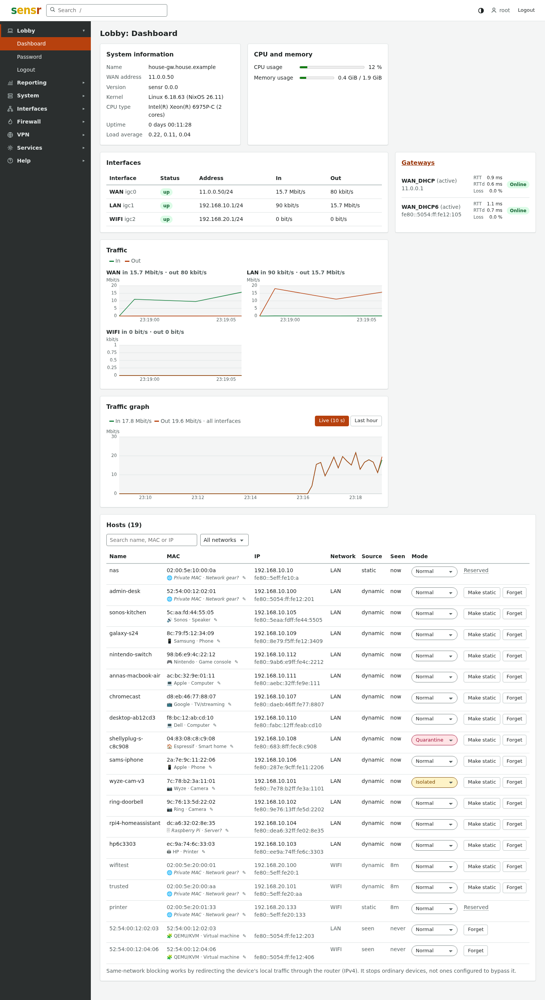

<p align="center"></p>

<p align="center"></p>

A firewall and router OS written in Rust on NixOS. The goal is feature parity with
[OPNsense](https://opnsense.org/), including its Business Edition features, plus
atomic upgrades, rollback and a typed, tested configuration model.

**Status: early, in development.** Releases v0.1.0 to v0.1.24 are on
[GitHub Releases](https://github.com/itpick/sensr/releases) with Raspberry Pi 4 and Pi 5 SD
images, an x86 ISO and a qcow2. The author's home router is a Raspberry Pi 5 running sensr,
upgraded from the in-app updater. It is still young: expect rough edges and missing OPNsense
features. For a mature option, see [opnsense-pi](https://github.com/itpick/opnsense-pi) or
[vyos-pi](https://github.com/itpick/vyos-pi). The plan is in [`docs/PLAN.md`](docs/PLAN.md).

What works today, briefly: host inventory with smart device labels, per-host Isolated and
Quarantine modes, per-host DNS activity (screen time per service, from Unbound dnstap),
global search, traffic graphs, IDS (Suricata), WireGuard, DNS blocklists, gateway monitoring,
OIDC, SAML and WebAuthn login, in-app updates, and boot-apply fault isolation with an
emergency firewall. CI is backed by a Cachix binary cache.

**Install page:** https://itpick.github.io/sensr/ (lists the images in the latest release)

**Related projects:**
- [opnsense-pi](https://github.com/itpick/opnsense-pi) ([download page](https://itpick.github.io/opnsense-pi/)): OPNsense images for Raspberry Pi 4/5
- [vyos-pi](https://github.com/itpick/vyos-pi) ([download page](https://itpick.github.io/vyos-pi/)): VyOS images for Raspberry Pi 4/5
- [OPNsense vs VyOS on the Pi 5](https://github.com/itpick/vyos-pi/blob/main/docs/comparison/pi5-iperf-vyos-vs-opnsense.md): side-by-side speed and boot-time results
- [Performance evaluation](docs/research/07-performance-evaluation.md): OPNsense, VyOS and a NixOS + Rust prototype compared on forwarding, boot and config apply

## Why

[opnsense-pi](https://github.com/itpick/opnsense-pi) showed what it costs to run OPNsense
on hardware FreeBSD barely supports. The Pi 5 needed out-of-tree Ethernet drivers with
receive-path patches, and 5 GbE USB NICs had no driver at all. Linux supports that
hardware in the mainline kernel. NixOS adds reproducible images and generation-based
rollback. OPNsense's own issue tracker shows the rest: most recurring bugs are
config-apply races, migrations and upgrade regressions, and typed Rust and a declarative
OS can design those out.

## Hardware

Targets: x86-64 (UEFI installer ISO, qcow2 image), Raspberry Pi 5 and
Raspberry Pi 4. Both Pi images boot straight from the card with the mainline
kernel, and bind each interface to a NIC by MAC address.

| Board | RAM | Notes |
|---|---|---|
| Raspberry Pi 4 | 2 GB minimum | Onboard `genet` plus one USB NIC is enough for a small home network. |
| Raspberry Pi 4 | 4 GB recommended | Headroom for IDS, large blocklists and connection tracking. |
| Raspberry Pi 5 | 2 GB usable, 4 GB and up recommended | Faster CPU and PCIe; 2.5/5 GbE USB NICs. |
| x86-64 | 2 GB minimum, 4 GB recommended | Under QEMU/KVM or on bare metal. |

2 GB is the floor: the firewall, DHCP, DNS, NAT and the web UI fit in it.
More RAM is what makes Suricata, big DNS blocklists and a busy connection
table comfortable. The author's home router is a Pi 5; the Pi 4 is supported too, on
both the 2 GB and 4 GB boards.

## Research (written with Fable)

| Doc | What it covers |
|---|---|
| [01 Feature inventory](docs/research/01-feature-inventory.md) | Every documented OPNsense feature and plugin, with stable IDs and the sensr backing for each |
| [02 Architecture](docs/research/02-architecture.md) | How OPNsense works, what to keep, what to redesign, and the crate map |
| [03 Test parity](docs/research/03-test-parity.md) | All 408 OPNsense tests and checks (T-0001 to T-0408), each mapped to a sensr test |
| [04a Core issues](docs/research/04a-issues-core.md) | All 7,984 opnsense/core issues: open, declined, most wanted, recurring bug classes |
| [04b Plugin issues](docs/research/04b-issues-plugins.md) | All 3,230 opnsense/plugins issues, plugin health, and a tier for each plugin |
| [05 Business features](docs/research/05-business-features.md) | Business Edition and its add-ons, competitor features, and the BIZ-001 to BIZ-032 plan |
| [06 Rust + NixOS stack](docs/research/06-rust-nixos-stack.md) | Lessons from opnsense-pi, OS base, a crate for each subsystem with its latest version, and the dependency freshness policy |
| [07 Performance evaluation](docs/research/07-performance-evaluation.md) | OPNsense, VyOS and a NixOS + Rust prototype compared on forwarding, boot, footprint and config apply |

## Layout

```
crates/   Rust workspace (see below)
docs/     plan, research, install page (GitHub Pages)
flake.nix NixOS modules, images, the router update and VM tests (the house test, boot tests)
```

Crates under `crates/`:

| Crate | Purpose |
|---|---|
| `sensr-agent` | Privileged daemon: owns the config store, runs the apply pipeline and commit-confirm |
| `sensr-api` | Unprivileged HTTP API (native REST, OPNsense compat façade, login incl. OIDC, SAML, WebAuthn) |
| `sensr-apply` | Apply engine: plans, typed commands, actions, templates, hooks, commit-confirm |
| `sensr-auth` | Authentication and authorization: privileges/ACL, password hashes, API keys |
| `sensr-cli` | The `sensr` command line |
| `sensr-config` | Config document store: revisions, history, audit |
| `sensr-dns` | DNS blocklists for Unbound, DHCP lease registration, resolver statistics |
| `sensr-feeds` | Alias data feeds: URL tables, GeoIP and ASN, host names, neighbour table |
| `sensr-fingerprint` | Smart host labels from an embedded OUI table and passive evidence |
| `sensr-flow` | Traffic accounting and IDS alert storage |
| `sensr-import-opnsense` | Lossless importer from an OPNsense `config.xml` |
| `sensr-ipc` | Typed IPC between the API/CLI and the agent |
| `sensr-monitor` | Gateway monitor (dpinger equivalent) |
| `sensr-net` | Network model and state, IPv6 prefix delegation |
| `sensr-rules` | Firewall rule IR, alias resolution, nftables renderer |
| `sensr-schema` | Typed config field types, constraints, versioned migrations |
| `sensr-schema-derive` | `#[derive(SensrModel)]` and `#[derive(SensrOptions)]` |
| `sensr-ui` | Leptos web UI with the OPNsense-style layout |
| `xtask` | Repository checks: test parity, source coverage, dependency freshness |

## Build

```sh
cargo check --workspace   # uses the toolchain pinned in rust-toolchain.toml (1.100.0)
nix develop               # dev shell with cargo-deny, cargo-audit, cargo-leptos, qemu
```

## Dependencies

Every dependency is at its newest stable release, and CI enforces it. Renovate opens the
bumps, and the nightly job fails if any direct dependency or flake input falls more than
14 days behind (see [06 §5](docs/research/06-rust-nixos-stack.md#5-dependency-freshness-policy)).

## License

Dual-licensed: [MIT](LICENSE-MIT) or [Apache-2.0](LICENSE-APACHE), at your option.

sensr is an independent project. It is not affiliated with Deciso B.V., and it contains
no OPNsense code. OPNsense® is a trademark of Deciso B.V. and appears here only to
describe compatibility.

## CI binary cache

Nix builds in CI (`ci.yml`, `release.yml`, `vm-screenshots.yml`) use a
[Cachix](https://cachix.org) cache so a release reuses what CI already built
for the same commit (the Pi toplevel from `nix-aarch64`, the crane dependency
closures). It is optional and off until configured, in repo settings:

- variable `CACHIX_CACHE`: the cache name. Setting it turns the step on; runs
  without a token (fork PRs) still pull from it.
- secret `CACHIX_AUTH_TOKEN`: a token with write access to that cache. Needed
  only to push, which happens on pushes to main, tags and manual dispatches,
  never on pull requests.

SD card, ISO and qcow2 images are filtered out of pushes to save space.
