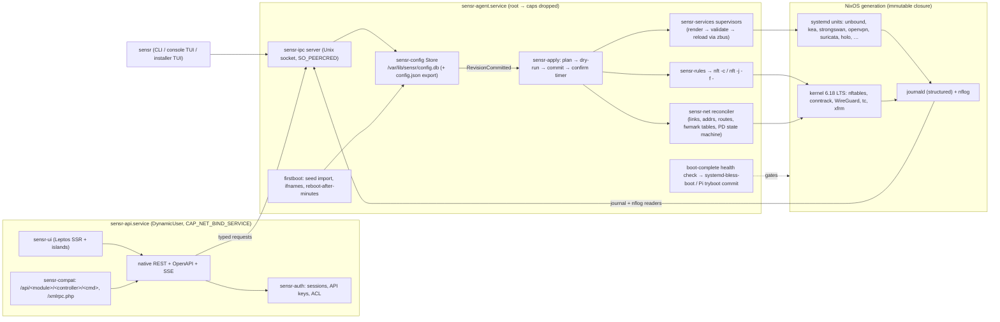

# sensr — master reconstruction plan

Status: v1, written 2026-11-15, status refreshed 2026-11-24. Phase 0 is done and
much of Phase 1 is shipped (releases v0.1.0 to v0.1.24; see §8). This is the
single plan that turns the seven research
documents in `docs/research/` into phases, crates, tests and tasks. It does not
repeat the research; it references it by ID (`IF-006`, `ISS-C-001`, `BIZ-014`,
`T-0006`). Per-ID tracking (status, owner, PR) lives next to the IDs in
`docs/research/01-feature-inventory.md` (features), `03-test-parity.md` (tests),
`04a`/`04b` (issues) and `05` (business); this document only assigns them to
phases.

**The OPNsense source code is the spec.** Full-history clones of
`opnsense/{core,plugins,docs,tools,changelog,update,ports}` live in
`reference/opnsense/<repo>` (gitignored, recreated by
`scripts/fetch-reference.sh`, commits pinned in `reference/REFS`: core
`8b88393`, plugins `af4166a`), and both issue trackers are in
`reference/opnsense-issues/{core,plugins}.jsonl`. Every research document and
every path cited in this plan resolves against those pins. We read the source
to learn behaviour and tests; we never copy it (BSD-2 upstream, MIT/Apache
here; clean room by construction, §2.6).

Decisions already made by the owner and not re-opened here: Rust everywhere it is
feasible; NixOS base; x86_64 installer ISO, Raspberry Pi 4/5 and qcow2 images;
own install page at `docs/index.html` (itpick.github.io/sensr) linked from the
opnsense-pi page; every dependency at its latest version, enforced by CI and
Renovate (06 §5); sensr has all 408 OPNsense tests plus more (03); all 464
documented features and both issue trackers feed the plan (01, 04a, 04b);
Business Edition features are in scope (05); the web UI keeps the OPNsense
layout (sidebar menu tree, top bar, page → form → grid) built with Leptos SSR +
islands, own CSS, no OPNsense assets; MIT OR Apache-2.0; never the OPNsense name
or branding for sensr; wordmark "s" green, "ens" yellow, "r" rusty red.

---

## 1. Vision, goals, non-goals, anti-goals

**Vision.** A firewall/router OS that an OPNsense administrator can sit down at
and use without reading a manual, that imports their `config.xml`, that runs on
hardware FreeBSD cannot drive (Pi 5, 5 GbE USB NICs), and whose two recurring
failure classes in OPNsense's own tracker — config apply/upgrade races and
migration breakage (04a §5) — are designed out rather than patched.

**Goals (measurable).**

| # | Goal | How we know |
|---|---|---|
| G1 | Feature parity with OPNsense 26.7 community + Business Edition | all 464 IDs in 01 are shipped, deferred with a reason, or marked X (§3 appendix) |
| G2 | Test superset | every T-0001..T-0408 has a passing sensr test; `xtask parity` reports 100 % and CI gates on a ratchet (§4) |
| G3 | Drop-in for existing automation | `sensr-compat` passes the recorded OPNsense API golden suite for Tier 1 endpoints; `terraform-provider-opnsense` acceptance tests pass against a sensr VM (02 §4.2) |
| G4 | Safe to operate remotely | commit-confirm apply, boot-counted generations with health-gated bless, dry-run of every rendered backend (`nft -c`, `kea-dhcp4 -t`, `unbound-checkconf`, …) before commit (ISS-C-001, -005, -016) |
| G5 | Fresh dependencies | nightly CI fails if any direct crate, daemon override or flake input is >14 days behind a stable release (06 §5) |
| G6 | Runs where opnsense-pi could not | Pi 5 with in-tree `macb`/RP1 and `r8152` (RTL8156/8157) drivers, Pi 4, x86_64 UEFI, qcow2; one `nix build` per image (06 §1 L5, L9) |
| G7 | Better than the original wherever the remake allows | every phase ships the "better than OPNsense" wins listed below, each with a test that would fail on OPNsense |

**Core principle: parity is the floor, not the ceiling.** The 464 features and
408 tests define what sensr must at least do. Wherever Rust, Linux or a
clean-slate design lets us do something better or more efficient overall —
performance, memory, correctness by construction, atomic apply, fewer daemons,
less boilerplate through derive macros, eBPF/XDP fast paths, one binary per
role, no shell glue — we do it, and we do not hold back to stay
"bug-compatible". Compatibility is preserved at the boundaries (config import,
API façade, UI familiarity), not in the implementation. Concrete wins per
phase:

| Phase | Better than OPNsense (each is a test, not a slogan) |
|---|---|
| 0 | Typed schema with derive macros replaces 61 model XMLs + 37 string-typed PHP field classes + per-module validation code: integers are integers, references are UUID-checked at compile/validate time, `lint-model` rules are compile errors (T-0348..T-0363). Migrations run once in a transaction with before/after goldens instead of on every boot against raw XML. One config document store with history/diff built in (SQLite + content hashes) instead of N full XML copies and shelling out to `diff`. Rule IR with two renderers makes the firewall semantics testable without a kernel. |
| 1 | Atomic `nft` ruleset swap after `nft -c` — a rule change never drops conntrack state or half-loads (vs `pfctl -f` with errors in `/tmp/rules.debug`). Policy routing in the routing layer: gateway changes never reload rules (ISS-C-006). One PD state machine with persisted lifetimes and RFC 9096 deprecation instead of dhcp6c hook scripts + `rc.newwanip*` + radvd regeneration (ISS-C-002; the 161-bug class). Dependency-ordered reconciler: DHCP renew with the same lease is a no-op, no `filter_configure_sync()` ×3 at boot (ISS-C-003). Commit-confirm and boot-counted generations with health-gated bless — safe remote operation OPNsense does not have. Visible, orderable auto-rules (ISS-C-008). Kea lease → resolver registration without restart (ISS-C-009, declined upstream). Lease and alias refresh keep last-good on failure with per-object status. Structured firewall log with the rule UUID in the record (no stale sequence → label mapping, FW-LOG-004). Two processes (privileged agent, unprivileged API) and sandboxed units instead of PHP-as-www + Python-as-root with `%s`-spliced shell commands. SSR UI arrives usable before any client code loads; grids page server-side so 10k rules stay fast. In-tree Pi 5 / 5 GbE USB drivers; images from one `nix build`. ntpd-rs with NTS by default. |
| 2 | Native DHCP server with the Dnsmasq ∪ Kea surface in one process (no three-daemon choice), HA lease replication and DNS registration built in. Multi-target quorum gateway probes (ICMP/TCP/HTTP/DNS, declined upstream) and explicit failback/"drop if down". CAKE SQM presets (impossible on FreeBSD). NAT64/DNS64/PREF64 and DS-Lite as core WAN types. Incremental FRR reload (sessions survive a static-route edit). Alias sets with no size ceiling and `nft add element` deltas. Suricata IPS via NFQUEUE/AF_PACKET/XDP without netmap's offload/VLAN constraints; HOME_NET follows prefixes automatically. Dual-stack captive portal sessions by MAC. Dedicated OTP field and WebAuthn-ready login (declined upstream). One backup engine for six plugins' worth of targets, with status and encryption. Typed renderers end the `%`/`,`/`@` escaping bug class across every wrapped daemon. Every API error is a real HTTP error with a field-addressed body; OpenAPI generated, not scraped. Typed mTLS section sync with node-local fields instead of XML-RPC with admin credentials and `verifypeer` off. Design tokens with built-in dark/high-contrast instead of six theme plugins. |
| 3 | OIDC, SAML, WebAuthn, scoped RBAC, tamper-evident audit log, authoritative DNS and WAF as open core features, not a paid tier. hickory-based authoritative server embedded (no PowerDNS + MySQL footprint). Coraza WAF as a Caddy handler with hot config reload. |
| 4 | Agent-dials-out fleet (works behind CGNAT without inbound rules), templates with semantic plan/diff and drift detection instead of overwrite-merge "classes", rollout waves with canaries and automatic rollback, remote console with recording, multi-tenant isolation with row-level security. eBPF/XDP fast paths (DDoS drop before conntrack, per-flow accounting without sampling) and conntrack-event IPFIX export with pre- and post-NAT tuples. |

**Non-goals.** Reusing OPNsense code or UI assets (clean-room; behaviour only).
Byte-compatible `pf.conf`/`filterlog` output (behaviour parity via nftables,
02 §4.3). A FreeBSD build. A TypeScript frontend. Pure-Rust replacements for
strongSwan, OpenVPN, Suricata, hostapd (06 §6: wrap, do not rewrite). CARP
wire compatibility (VRRPv3 instead; 06 §3.12).

**Anti-goals — outcomes that count as failure even if the software works.**

- A config apply that can brick a remote router: every apply that touches the
  management path is provisional until confirmed (ISS-C-016); every rendered
  backend is dry-run checked before swap (ISS-C-001); the OS generation is not
  blessed until the API answers on the management interface (06 §2.4).
- Unpinned or outdated dependencies: no "we'll bump later". `rust-toolchain.toml`,
  `Cargo.lock`, `flake.lock` and `nix/overlays` version pins are the only
  sources of versions; Renovate and the nightly freshness job enforce them.
- A UI that is unfamiliar to OPNsense admins: same menu tree names and order,
  same page/tab/field names and help text semantics, same grid interactions
  (search, paging, enable toggle, clone/edit/delete, drag-order), same
  "Apply changes" banner behaviour (06 §3.14 table).
- Silent acceptance: an API mutation with invalid input never returns 200
  (04a §5.6); an importer never drops a node silently (02 §4.1).
- A hidden auto-rule: every automatically generated firewall rule is a visible,
  orderable, toggleable object (ISS-C-008).
- A migration that loses data: every schema change ships a migration with a
  before/after golden pair and runs against the fixture corpus in CI (ISS-C-004).
- Using the OPNsense name for anything but factual compatibility statements.

---

## 2. Reconciled architecture

02 and 06 were written independently and disagree in places. The following is
final.

### 2.1 Resolved inconsistencies

| Topic | 02 says | 06 says | Decision |
|---|---|---|---|
| Apply engine name/process | `sensr-apply`, in-process module of one `sensrd` (split "deferred") | `sensr-agent` privileged daemon, `sensr-api` unprivileged | **Two processes.** `sensr-agent` (root, caps dropped to `CAP_NET_ADMIN`/`NET_RAW`/`NET_BIND_SERVICE`/`SYS_ADMIN` for mounts) hosts the apply engine, which stays a library crate named `sensr-apply`. `sensr-api` (DynamicUser) hosts axum + Leptos SSR + the OPNsense compat façade and owns no state except sessions. Typed IPC over a Unix socket (§2.3). |
| Config store | `/var/lib/sensr/config.sensr` JSON + `history/<rev>.sensr` files | SQLite `config.db` via `rusqlite` + exported `config.json` | **SQLite is the store, JSON is the interchange.** `/var/lib/sensr/config.db` (WAL) holds revisions as canonical JSON text blobs, blake3 content hash, revision metadata (`username`, `time`, `description`, `impersonated_by`, `user_apitoken` — OPNsense-compatible), audit rows and the secrets table. After every commit the head is also written atomically to `/var/lib/sensr/config.json` (mode 0600, secrets replaced by references) so operators can diff, git it, or copy it to a seed partition. Backups/exports are JSON (`.sensr.json`) optionally `age`-encrypted. |
| Who writes the store | API writes config directly | agent applies | **Agent owns `/var/lib/sensr` exclusively.** Commits, reads, history and apply all go through the agent IPC; the API process cannot read secrets from disk. |
| CLI name | `sensrctl` | `sensr` | **`sensr`** (binary of crate `sensr-cli`). Subcommands mirror `configctl`/`pluginctl`/`opnsense-update`: `sensr config get/set/diff/import/validate/migrate`, `sensr apply [--dry-run] [--confirm-within]`, `sensr action run <name>`, `sensr upgrade`, `sensr diag`, `sensr version --json`, `sensr shell` (console TUI). |
| Crate list | 15 crates incl. `sensr-net`, `sensr-services`, `sensr-auth`, `sensr-api-compat`, `sensr-plugin`, `sensr-ha`, `sensr-backup` | `sensr-netlink`, `sensr-dhcp`, `sensr-ra`, `sensr-ddns`, `sensr-monitor` | **Union, renamed where needed** — final map in §2.2. `sensr-api-compat` → `sensr-compat`; `sensr-netlink` folds into `sensr-net`. |
| nftables access | pure netlink (`nftnl`/`rustables`), no `nft` binary | `nftables` JSON crate via `nft -j -f -` | **JSON via `nft`** for the ruleset (one atomic transaction, `nft -c` dry-run is exactly ISS-C-001), `rustables` later for hot set-element updates. Pure-netlink ruleset path is a §7 roadmap item, not a dependency. |
| Recursive DNS | 01: Unbound first, hickory later | 06: hickory default, Unbound optional | **Unbound wrapped at MVP** (parity surface DNS-UB-001..011 and T-0334..T-0342 are Unbound-shaped; `unbound-control local_data` gives lease registration without restart, ISS-C-009/-019). `sensr-dns` on hickory arrives in Phase 3 as the **authoritative** server (BIZ-020, DNS-BIND-001) and as an optional recursor. |
| DHCP server | 01: one native Rust server with the Dnsmasq ∪ Kea surface | 06: wrap Kea 3.2.1 until `sensr-dhcp` passes conformance | **Native schema from day one, Kea as the first renderer.** Phase 1 ships Kea driven over its control socket plus native lease → Unbound registration. `sensr-dhcp` (on `dhcproto`) becomes default in Phase 2 after the conformance suite in §4.6 passes; the Dnsmasq-style tag/boot/range surface (DHCP-DM-*) is native-only. |
| WAN clients | 01: native DHCPv4/DHCPv6 clients for ISP option fidelity (IF-PAT-007) | 06: systemd-networkd first | **DHCPv6/PD native in Phase 1** (the PD state machine must be ours, ISS-C-002 is P0); **DHCPv4 via networkd in Phase 1**, native in Phase 2 (raw send/request options for Orange/SFR/Sky recipes). |
| RA daemon | native `sensr-ra` | networkd `IPv6SendRA` interim, `radvd` fallback | **Native `sensr-ra` in Phase 1** (it is a derived view of the PD state machine). |
| CARP replacement | 01: native Rust VRRPv3, keepalived interim | 06: Holo (Rust) VRRP + routing | **Holo** wrapped via gRPC (Rust, MIT, also gives BGP/OSPF/BFD); keepalived is the fallback if Holo VRRP misbehaves in the HA lab. Maintenance mode/demotion/unicast semantics (IF-VIP-004/005) are implemented in `sensr-ha` on top of Holo's priority. |
| NTP | 01: chrony | 06: ntpd-rs | **ntpd-rs 1.9** default (Rust, NTS). chrony only when GPS/PPS refclocks are configured (NTP-002/003). |
| Reverse proxy / WAF | 01: Caddy + Coraza default, HAProxy/nginx optional; 06: Pingora `sensr-proxy` | | **Caddy + Coraza** (first-party module, also BIZ-019 stage 1) and **HAProxy** first-party; nginx community; a Pingora-based `sensr-proxy` is not on the roadmap until Phase 4 demand says otherwise. |
| Fleet manager | 05: separate `sensr-fleet` service, Postgres | — | Kept as 05 describes; lives in this repo as `crates/sensr-fleet` from Phase 4 (may move to its own repo then). |

### 2.2 Final crate map

Crates are created in the phase that first needs them; the scaffold already has
the eight marked ✓.

*Status note, 2026-11-24.* The research docs (02, 03) and the table below name
`sensr-services` and `sensr-api-compat`; neither crate exists. Their jobs landed
in the real crates: per-daemon rendering and reload in `sensr-apply`, DNS
blocklists and lease registration in `sensr-dns`, alias data feeds in
`sensr-feeds`, and the REST API and OPNsense compat façade in `sensr-api`.
Others that were not in the original map: `sensr-fingerprint` (smart host
labels), `sensr-flow` (traffic accounting and IDS alerts), `sensr-monitor`
(gateway monitor), `sensr-ipc` and `sensr-schema-derive`. `ls crates` is the
authoritative list.

| Crate | Kind | Responsibility | OPNsense counterpart | Phase |
|---|---|---|---|---|
| `sensr-schema` ✓ | lib (no_std-friendly core, wasm-safe) | field newtypes (`Port`, `Protocol`, `Ipv4Net`, `Hostname{…}`, `MacAddr`, `Relation<T>`, `Csv<T>`, `Secret<T>`…), constraints, `#[derive(SensrModel)]`, migration registry, JSON Schema export, `testing::{validate, validate_err}` | `Base/FieldTypes`, `Base/Constraints`, `BaseModel`, model XMLs, `Migrations/` | 0 |
| `sensr-schema-derive` | proc-macro | the derive + `#[sensr(...)]` attributes; `lint-model` rules as compile errors (T-0348..T-0363) | `Mk/lint.mk lint-model` | 0 |
| `sensr-config` ✓ | lib | `Document` (typed root), `Store` (SQLite + JSON export), revisions/history/diff, audit, migration runner, `RevisionCommitted` events | `Core/Config.php`, `config.inc`, `BackupController` | 0 |
| `sensr-import-opnsense` ✓ | lib | `config.xml` → generic tree (listtags) → section mappers → `Document` + import report; export of the mapped subset back to XML; legacy-section translators; FreeBSD ifname → MAC/assignment step | `convert_config()`, legacy mappers, `ConfigMaintenance` | 0 |
| `sensr-rules` ✓ | lib | rule IR, system rules (`system_rules.toml`), alias kinds + resolvers (hermetic fetch traits), nft renderer (JSON), pf-text renderer (test oracle), `calcRuleHash` reproduction | `Firewall/*Rule.php`, `filter.inc`, `filter.lib.inc`, `scripts/filter/lib/alias` | 0 |
| `sensr-net` | lib | rtnetlink wrappers, interface model + stable identity (`systemd.link` generation), VLAN/bond/bridge/tunnels, addresses, routes, policy-routing tables (fwmark), gateways + monitor, PD state machine, ethtool, wl-nl80211 | `interfaces.inc`, `Interfaces/*`, `Routing/*`, dpinger | 0 (pd), 1 |
| `sensr-apply` | lib | `Plan { files, nft, units, routes, hooks }`, planner, transactional apply with per-backend dry-run and rollback, commit-confirm timer, `ActionRegistry` (typed actions with privilege/cache/stream flags), minijinja templates + `Targets`, hook levels, `cmd::safe_format` | `configd.py`, `template.py`, `actions.d`, `rc.syshook` | 0 |
| `sensr-ipc` | lib | request/response + stream frames between api/cli and agent: length-prefixed CBOR (`ciborium`) of a versioned `Request`/`Response` enum, `SO_PEERCRED` auth, cancellation | configd socket protocol (`\0\0\0` terminator, T-0317) | 0 |
| `sensr-services` | lib | one module per wrapped daemon behind Cargo features: `unbound`, `kea`, `strongswan` (VICI), `openvpn` (mgmt socket), `suricata` (EVE), `hostapd`, `frr`, `holo`, `conntrackd`, `caddy`, `haproxy`, `freeradius`, `ntpd-rs`, `chrony`, `lldpd`, `net-snmp`, `miniupnpd`, `nut`, …; each implements `render → validate → commit → reconcile`, declares `ha_placement`, reload semantics and interface-scoped event subscriptions (ISS-P-010/-020/-025/-026) | `plugins.inc.d/*.inc`, `templates/OPNsense/*` | 1+ |
| `sensr-auth` | lib | local (argon2id), TOTP, LDAP, RADIUS, voucher, OIDC, WebAuthn, API keys (bcrypt-compatible import), sessions, privileges/ACL (URL patterns + route attributes), scoped RBAC later | `Auth/*`, `Core/ACL.php`, `auth.inc` | 0 (ACL), 1 |
| `sensr-api` ✓ | bin | axum HTTPS server: native versioned REST + OpenAPI (`utoipa`), SSE/WebSocket streams, Leptos SSR host (`leptos_axum`), serves `sensr-ui` islands, mounts `sensr-compat` at `/api/` and `/xmlrpc.php` | lighttpd + Phalcon controllers | 0 skeleton, 1 |
| `sensr-compat` | lib | `/api/<module>/<controller>/<command>` grammar, `key:secret` Basic auth, `{result, validations, uuid}` envelopes, option `{value,selected}` expansion from schema metadata, `search*/get*/add*/set*/del*/toggle*` CRUD, `core/firmware|backup|service/*`, `diagnostics/log/*`, XML-RPC `opnsense.restore_config_section` for the migration window | `ApiControllerBase`, `ApiMutable*ControllerBase`, `xmlrpc.php` | 2 |
| `sensr-ui` ✓ | lib (Leptos, SSR + islands) | `<MenuTree>`, `<TopBar>`, `<SettingsForm<T>>` generated from schema metadata, `<Grid<T>>` island (server-side paging/search), `<Dialog>`, `<ApplyBanner>`, `<LiveLog>`, dashboard widgets, design tokens with light/dark/high-contrast (ISS-P-027) | Volt views + jQuery/bootgrid/Tabulator | 0 shell, 1 |
| `sensr-cli` ✓ | bin `sensr` | API/IPC client, console menu TUI (`ratatui`, PLAT-003), installer TUI on the ISO, `sensr diag`, `sensr version --json` | `configctl`, `pluginctl`, `opnsense-shell`, `opnsense-update` | 0 |
| `sensr-agent` ✓ | bin | privileged daemon: loads/migrates head revision, runs `sensr-apply` at boot and on request, hosts `sensr-net` reconciler, `sensr-services` supervisors, firstboot seed import, boot-complete health check, Pi `tryboot` commit | configd + `rc.bootup` + `rc.syshook` | 0 |
| `sensr-dhcp` | lib + bin | DHCPv6 client (IA_NA/IA_PD, raw options, DUID control) and PD state machine driver (Phase 1); DHCPv4 client (Phase 2); DHCPv4/v6 server + relay with Dnsmasq ∪ Kea surface (Phase 2) on `dhcproto` | dhclient, dhcp6c, kea, dnsmasq, dhcrelay | 1, 2 |
| `sensr-ra` | lib + bin | RFC 4861/8106/8781 RA daemon fed by the PD state machine; CARP/VRRP-aware source address and lifetime-0 on demotion | radvd | 1 |
| `sensr-monitor` | lib | gateway probes (ICMP/TCP/HTTP/DNS, multi-target quorum, EWMA), Monit-style service/host/resource tests and alert actions, health graphs sampler (RRD replacement) | dpinger, monit, rrd | 1 (gateways), 2 |
| `sensr-fwlog` | lib | nflog group reader → structured journald records with rule UUID/label; live-view SSE source | filterlog, `read_log.py` | 1 |
| `sensr-backup` | lib | revision export/import, `age` encryption, OPNsense encrypted-backup reader, providers (local, WebDAV/Nextcloud, S3, git via `gix`, SFTP via `russh`, Google Drive, mail) with status API and retention (ISS-P-021) | `library/OPNsense/Backup/*`, five backup plugins | 1 (local), 2 |
| `sensr-ddns` | lib | DDNS engine, provider descriptors as data, per-hostname A/AAAA change detection, multi-WAN/VRRP aware (ISS-P-004/-005); provider trait shared with ACME DNS-01 | ddclient, dyndns, rfc2136 | 2 |
| `sensr-acme` | lib | `instant-acme` client, HTTP-01 answered by `sensr-api` listener, TLS-ALPN-01, DNS-01 via `sensr-ddns` providers, order state machine in the trust store, `cert.updated` events (ISS-P-001..-003, -011) | os-acme-client | 2 |
| `sensr-portal` | lib | captive portal zones (axum vhost per zone, nft sets, vouchers, RADIUS accounting, RFC 8908), later user self-service portal (BIZ-022) | CaptivePortal, User Portal | 2, 3 |
| `sensr-flow` | lib | conntrack events → NetFlow v5/v9/IPFIX exporter and local aggregator (Insight) | ng_netflow, flowd | 2 |
| `sensr-ha` | lib | VRRP instance management on Holo, maintenance mode/demotion, section sync (typed, UUID-keyed, node-local field exclusion), conntrackd driver, CARP hook events | `Hasync.xml`, `rc.filter_synchronize`, pfsync | 2 |
| `sensr-plugin` | lib | `Plugin` trait + `Manifest { menu, acl, actions, templates, syslog, ha_sections, services, hooks, widgets }`; compiled-in first-party modules behind features; out-of-tree modules as NixOS modules + manifest + separate binary on the typed IPC | `plugins.inc`, `Mk/plugins.mk` | 2 |
| `sensr-dns` | lib + bin | hickory-based authoritative server (static + RFC 2136/TSIG zones, AXFR/IXFR/NOTIFY, DNSSEC optional) and optional recursor/blocklist front | BIND plugin, OPNDNS | 3 |
| `sensr-audit` | lib | hash-chained, signed, structured audit log; `sensr audit verify` (BIZ-005) | audit syslog facility | 3 |
| `sensr-fleet` | bin | central manager: enrolment CA, agent tunnel, inventory, templates, rollout waves, alerts, central backups/logs (BIZ-013..018, 021, 023, 025..032) | OPNcentral | 4 |
| `xtask` | bin | `cargo xtask parity|source-coverage|upstream-diff|lint-*|golden-update|freshness|bundle-size` (T-0343..T-0390 equivalents, §4; `reference/COVERAGE.toml`, §2.6) | `Mk/lint.mk`, `Scripts/*` | 0 |
| `nix/` | Nix | overlays (`pkgs.sensr-*` via crane, daemon version overrides), `services.sensr` module, images (`iso-installer`, `raw-efi`, `pi4`, `pi5`, `qcow`), `nix/tests/*.nix` | `tools/`, `rc.*`, opnsense-pi | 0 |

### 2.3 Process model



Rules of the split:

- `sensr-api` holds no persistent state except sessions (`tower-sessions`, in
  memory, re-login after restart is acceptable) and the TLS key it is handed
  via a systemd credential. It cannot read `/var/lib/sensr`.
- Every IPC request carries the authenticated principal (user, API key or
  `impersonated_by` chain) so the agent writes OPNsense-shaped revision metadata
  and the audit log; authorization is decided in `sensr-auth` **before** the
  request leaves the API process and re-checked by the agent against the
  privilege the request declares.
- Streams (live firewall log, conntrack top, packet capture, `pftop`-style)
  are IPC stream frames forwarded as SSE/WebSocket; no shell-outs from the API.
- `std::process::Command` is allowed only inside `sensr-apply::cmd` (clippy
  `disallowed-methods`, T-0372), where arguments are typed and formatted by
  `safe_format` (T-0005).

### 2.4 Config-application model (hybrid)

1. **Immutable OS closure.** Kernel, systemd, sensr binaries, every wrapped
   daemon and its unit with `ExecReload`, hardware profile. Changing any of
   these is a new NixOS generation (`sensr upgrade`, boot-counted, rollback on
   failed health; 06 §2.4). Nothing config-specific lives in the closure.
2. **Typed runtime config.** One versioned `Document` (`sensr-schema` types,
   semver `schema_version`, per-module migrations). Edits are **commits**
   (OPNsense "Save"): validated as a whole (field, cross-field, referential
   integrity, ISS-C-025), stored as a new revision, not yet applied for
   subsystems that batch (interfaces, rules, NAT, aliases) — the UI shows the
   pending-changes banner exactly as OPNsense does; subsystems that OPNsense
   applies on save (most service pages) apply immediately.
3. **Apply = plan → dry-run → commit → confirm.** `sensr-apply` diffs the
   applied revision against the head, produces a `Plan` (netlink operations in
   dependency order physical → VLAN → bond/bridge → PPPoE → addresses → routes
   → tunnels → nft ruleset → services), renders every backend file into
   `/run/sensr/<daemon>/.next/`, runs each backend's checker (`nft -c`,
   `kea-dhcp4 -t`, `unbound-checkconf`, `swanctl --load-all` against a test
   socket, `openvpn --test-crypto`/`--config … --mode`, `suricata -T`,
   `frr-reload.py --test`, `caddy validate`, `haproxy -c`), and only then swaps
   and reloads. Any failure aborts the whole apply with the daemon's message
   attached to the offending object (ISS-C-001). `sensr apply --dry-run` prints
   the plan (ruleset diff via `nft -j list ruleset`).
4. **Commit-confirm.** An apply that touches the management path (management
   interface, its addresses/routes, rules matching the management listener,
   the listener itself, auth servers) is provisional: unless confirmed from a
   working session within N minutes (default 5) the previous applied revision
   is re-applied (ISS-C-016, 06 §1 L4). Optional for every apply.
5. **Boot path = apply path.** At boot the agent loads the head revision, runs
   pending migrations in a transaction (refuses to start on failure, no
   half-migrated state), and runs the same full plan (ISS-P-010). No shell
   hooks; `rc.syshook.d`-style operator drop-ins at `/etc/sensr/hooks/<level>/`
   are invoked by the agent at the documented hook levels (02 §2.7).
6. **Declarative mode.** `services.sensr.configFile` in the NixOS module makes
   a store path the source of truth: the agent applies it at boot, the UI is
   read-only ("managed by Nix"), and a config change is a `nixos-rebuild`.
   This is how `nix/tests/*.nix` express a whole box in one attrset.
7. **Secrets.** `Secret<T>` fields are write-only in the API and UI, stored in
   a separate table with their own file mode, redacted in logs and in the
   anonymised support export (ISS-C-014).
8. **Runtime state** (leases, sessions, bans, alias contents, PD prefixes,
   counters) lives in `/var/lib/sensr/state/` (`redb`/SQLite), never in the
   config document (ISS-P-013); the API serves it as a `State` overlay for
   volatile compat fields (02 §2.2).

### 2.5 Compatibility strategy

- **`config.xml` importer** (`sensr-import-opnsense`): `quick-xml` into a
  generic tree; OPNsense list semantics (`listtags()` table + "repeated sibling
  ⇒ list", T-0002); per-section pure mappers selected by the model `version`
  attribute (re-implementing upstream migrations' effects behaviourally);
  legacy sections (`filter/rule`, Outbound NAT, legacy OpenVPN/IPsec/ISC DHCP,
  `interfaces.php` fields, Unbound domain overrides) translated to current
  objects (FW-013, NAT-007, VPN-OVPN-009, VPN-IPSEC-015, DHCP-ISC-001,
  DNS-UB-003); unknown nodes preserved in an `unmapped` side tree and reported
  (never dropped); FreeBSD device names mapped to Linux devices by MAC when
  present, else an interactive/`seed`-driven assignment step (02 §4.3);
  OPNsense rule labels (`calcRuleHash` md5) reproduced so SIEM/dashboards keep
  working (02 §5); API key bcrypt hashes imported unchanged; the OPNsense
  encrypted-backup container is readable (02 §2.12). Export of the mapped
  subset back to `config.xml` exists for round-trip tests (T-0035) and for
  users who want to go back.
- **API façade** (`sensr-compat`): Tier 1 shape-compatible endpoints first
  (auth, `core/firmware/status|info`, `core/backup/*`, `core/service/*`,
  `firewall/filter|alias|alias_util|source_nat|d_nat|category|group/*`,
  `interfaces/vlan_settings|overview/*`, `routes/*`, `routing/settings/*`,
  `unbound/*`, `kea/*`, `wireguard/*`, `auth/user|group/*`, `trust/*`,
  `diagnostics/interface|firewall|log/*`), Tier 2 remaining core, Tier 3
  plugins as modules land (02 §4.2). Mapping table `compat/endpoints.toml`
  plus hand-written adapters; golden JSON recorded from an OPNsense 26.7 VM.
  Terraform provider acceptance runs nightly against a sensr VM. The XML-RPC
  `opnsense.restore_config_section` endpoint is accepted so an OPNsense master
  can sync to a sensr backup during migration (02 §2.13).
- **Behavioural, not textual, parity** for pf → nftables, `filterlog` → nflog,
  pfsync → conntrackd, CARP → VRRP, ZFS BEs → generations: each has a
  semantics table (`crates/sensr-rules/docs/pf-to-nft.md` is the first) and VM
  tests. pf features nftables cannot express (`os` fingerprinting, `modulate
  state`, some `scrub` options) **import with a degradation warning** in the
  import report, never a hard failure (resolves 02 §5 bullet 1).

### 2.6 Working from the OPNsense source

The source tree under `reference/opnsense/` is the specification; the research
documents are the index into it. Paths below are relative to
`reference/opnsense/core/` unless stated (plugins: `reference/opnsense/plugins/
<category>/<name>/`).

**Where behaviour lives (what to read for a feature).**

| Artefact | Path (pinned core `8b88393`) | Count | What it tells us |
|---|---|---|---|
| Model XML (schema, defaults, options, constraints, version) | `src/opnsense/mvc/app/models/OPNsense/<Module>/<Model>.xml` | 61 | field types, `Required`/`Multiple`/`Mask`/`BlankDesc`, option lists, `<Constraints>`, migration version |
| Model PHP + custom field types + migrations | `models/OPNsense/<Module>/{<Model>.php,FieldTypes/*,Migrations/*}` | 64 migrations | `performValidation()` extras, relation lookups, what each version change moved |
| API controllers | `src/opnsense/mvc/app/controllers/OPNsense/<Module>/Api/*Controller.php` | 235 | endpoint names, envelopes, which configd actions they call, service reconfigure semantics |
| UI forms / grids / menus / ACL | `controllers/OPNsense/<Module>/forms/*.xml`, `views/OPNsense/<Module>/*.volt`, `models/OPNsense/<Module>/{Menu/Menu.xml,ACL/ACL.xml}` | 19 menus, 19 ACLs | field order, labels, help text semantics, tabs, grid columns, privilege names and URL patterns |
| configd actions | `src/opnsense/service/conf/actions.d/actions_<module>.conf` | 31 files / 365 actions | the backend verb set, parameters, which are cron-schedulable (`description`), cacheability, streaming |
| Templates (daemon configs) | `src/opnsense/service/templates/OPNsense/<Module>/{*.conf,+TARGETS}` | 109 files | exactly which daemon options a UI setting maps to |
| Helper scripts | `src/opnsense/scripts/<area>/*.{py,sh,php}` | 343 | status parsing, alias resolution, log formats, firmware flow — behaviour to re-specify, not port |
| Legacy orchestration | `src/etc/inc/*.inc`, `src/etc/rc.*`, `src/etc/rc.syshook.d/` | 12.7k lines | interface bring-up order, system rule set (`filter.lib.inc`), hook levels |
| Tests | `src/opnsense/mvc/tests/app/**`, `src/opnsense/service/tests/`, `src/opnsense/scripts/*/tests/` | 408 rows in 03 | the acceptance oracle; fixtures copied verbatim into our corpus |
| Docs | `reference/opnsense/docs/source/manual/**`, `how-tos/**`, `vendor/**` | | user-visible behaviour and recipes (01 is built from these) |
| Build/images/update | `reference/opnsense/tools/`, `update/`, `ports/` | | image flavours, update sets, which ports are patched and why (daemon version quirks we must know when wrapping) |
| Changelog | `reference/opnsense/changelog/community/*`, `business/*` | | what changed per release; drives the migration corpus boundaries |
| Issues | `reference/opnsense-issues/{core,plugins}.jsonl` | 7,984 + 3,230 | the bug classes and declined requests behind ISS-C/ISS-P; grep by `#NNNN` |

**Per-module rewrite workflow** (the unit of work is an OPNsense model or
page, e.g. `Firewall/Alias`, `Kea/KeaDhcpv4`, `Unbound/Unbound`):

1. **Pick** the module from the phase scope (§3) and open its model XML, PHP
   model, API controller(s), form XML, menu/ACL entries, the configd actions
   it calls, the templates those render, and the scripts behind them. Note
   the OPNsense model `version` and list its migrations.
2. **Read behaviour, not code.** Write down (in the PR description, later in
   the crate's `docs/<module>.md`) the field set with types/defaults/options,
   cross-field rules, the action verbs and their effects, the rendered daemon
   options, and every quirk the tests or issues pin (grep the jsonl for the
   module). Cross-check against 01 (feature rows), 03 (test rows), 04a/04b
   (ISS items) and the docs page; fix the research docs if the source
   disagrees with them.
3. **Tests first.** Add the parity tests for the module's T-IDs, then the
   tests the module needs that OPNsense lacks (golden render against a fixture
   document, dry-run check with the real daemon binary, property tests for the
   validators, nixosTest when behaviour is end-to-end). Test names carry the
   T-ID token and the feature ID appears in a `/// Covers: IF-006, FW-AL-002`
   doc comment on the test module so `xtask parity` and `xtask
   source-coverage` can both find it.
4. **Implement idiomatically in Rust.** Model = `#[derive(SensrModel)]` struct
   in `sensr-schema` (or the owning crate), actions = typed `Action` variants,
   templates = minijinja with the typed document, status = parsed into typed
   structs. Never translate PHP line by line; never copy code, comments,
   strings or template files from `reference/` into `crates/` or `nix/`
   (fixtures under `tests/fixtures/opnsense/` are the only verbatim copies and
   keep their BSD-2 attribution). Where the clean-slate design is better
   (§1 principle), do the better thing and record the deviation in the
   module's `docs/<module>.md` "Differences from OPNsense" table so the
   importer, the compat façade and the UI help text can present it.
5. **Register coverage.** Update `reference/COVERAGE.toml` (below) for every
   upstream path the PR consumes, and the 01/03 rows' status.

**Tracking source coverage.** `reference/COVERAGE.toml` maps every file of
the pinned core and plugins trees that carries behaviour — model XML/PHP,
migrations, API controllers, form XMLs, Menu/ACL XMLs, `actions_*.conf`,
templates, scripts, `etc/inc/*.inc`, `rc.*`, syshooks, PHPUnit/Python tests —
to a sensr crate/module and a status:

```toml
[["src/opnsense/mvc/app/models/OPNsense/Firewall/Alias.xml"]]
crate = "sensr-rules"
module = "alias::model"
status = "done"            # todo | in-progress | done | n-a (with reason) | deferred (phase)
features = ["FW-AL-001", "FW-AL-002"]
tests = ["T-0204", "T-0333"]
note = "counters are a State overlay field, not schema"
```

`cargo xtask source-coverage` walks `reference/opnsense/{core,plugins}` at the
pinned commits with the same path globs, fails if any behaviour-carrying file
is missing from the manifest (so a new upstream file shows up as `todo`, never
silently), reports coverage per OPNsense module and per sensr crate, and
writes the badge next to the parity badge. The manifest is checked in; the
reference tree is not. A PR that adds a model/action/template to sensr must
move the corresponding rows to `done`; CI compares `COVERAGE.toml` against
`reference/REFS` so a stale manifest (pin bumped, manifest not) fails.

**Following upstream changes.** OPNsense moves every two weeks. Monthly (or
when a release lands): `scripts/fetch-reference.sh --latest --issues` updates
the clones, rewrites `reference/REFS` and refreshes the issue jsonl. Then:
`git -C reference/opnsense/core diff <old-pin>..<new-pin> --stat -- src/
opnsense/mvc/app/models src/opnsense/service/conf/actions.d src/opnsense/
service/templates src/etc/inc` (an `xtask upstream-diff` wrapper prints the
per-module list, the new/changed model versions and migrations, new actions,
new test methods, and the changelog entries between the pins). Each changed
model version becomes an importer task (new mapper version + before/after
migration pair in our corpus), each new PHPUnit/Python test becomes a new
T-row appended to 03, each new feature in the changelog becomes a new row in
01, and the `COVERAGE.toml` rows for changed files are flipped back to
`in-progress` until reviewed. The pin bump PR carries this review; the
research docs' "Status" headers record the new pins.

---

## 3. Phased roadmap

Phases are sequential at the exit-criteria level but overlap in practice.
Durations are for a small team (2–3 engineers) and are estimates, not promises.
"opnsense-pi daily-driver config" means the owner's production `config.xml`
from the opnsense-pi Pi 5 (anonymised copy committed to the private corpus,
see §7 Q1).

### Phase 0 — Foundation (≈ 3 months)

**Goal.** The architecture-gating decisions (ISS-C-001, -002, -003, -004,
-006, -007, -017; 04a §6.1) exist as code with their test harnesses, the
parity gate is wired into CI, and a qcow2 image boots an agent/API skeleton.
Nothing routes packets yet.

**Scope.**
- `sensr-schema` + derive: all field types, constraints, migrations, JSON
  Schema export, `lint-model` rules as compile errors.
- `sensr-config`: SQLite store, revisions, history/diff, audit, migration
  runner, JSON export, fixture corpus loader.
- `sensr-import-opnsense`: XML tree + listtags, mapper framework, fixture
  corpus (all 13 upstream fixtures + `config.xml.sample` + the service test
  config), import report, round-trip tests; mappers for `system`, `interfaces`,
  `filter`, `nat`, `OPNsense/Firewall/*`, `unbound`, `Kea`, `wireguard`,
  `system/user|group|apikeys`, `trust` (what Phase 1 needs).
- `sensr-rules`: IR, three upstream fixtures as pf-text goldens, nft renderer
  goldens with `nft -c` in CI, system rules as data, alias kinds + hermetic
  resolvers, `calcRuleHash`.
- `sensr-net::ipv6::pd` pure functions; PD state machine type and persistence
  (no client yet).
- `sensr-apply`: `Plan`, `ActionRegistry`, `cmd::safe_format`, minijinja +
  `Targets` with a shipped `Sample` module, hook levels, commit-confirm timer
  logic (unit-tested with a fake clock).
- `sensr-ipc`: frames, `SO_PEERCRED`, stream frames; `sensr-agent` and
  `sensr-api` skeletons speaking it; `sensr config get / --json` end to end.
- `sensr-auth::acl`: privilege model + URL matcher with the upstream fixture.
- `sensr-ui`: shell only — `<MenuTree>` from a menu manifest, `<TopBar>`,
  login page, design tokens (light/dark), one generated `<SettingsForm<T>>`
  (System › Settings › General) and one `<Grid<T>>` (Firewall › Aliases) wired
  to the IPC; wasm bundle-size budget check in CI.
- `xtask`: `parity`, `source-coverage`, `upstream-diff`, `lint-*`,
  `golden-update`, `freshness`, `bundle-size`; `reference/COVERAGE.toml`
  seeded with every behaviour-carrying path in the pinned core and plugins
  trees (all `todo` except what Phase 0 consumes).
- `nix/`: overlay with crane build, `services.sensr` module, `qcow` image,
  `nix/tests/boot-first-run.nix` (skeleton: units active, IPC answers,
  selftest checks T-0391..T-0393, T-0401), binary cache publishing from CI.
- Install page: keep "Planned", add seed-file table matching §6.

**Exit criteria (all testable).**
- `cargo xtask parity` ≥ 60 % overall and 100 % for T-0001..T-0072,
  T-0073..T-0291, T-0317..T-0323, T-0343..T-0390 (lint rows may map to the
  type system; each still has a test or xtask check), T-0391..T-0393, T-0401.
- Every fixture `config.xml` in the corpus imports with zero *unexpected*
  unmapped nodes (expected ones enumerated in the golden report) and the
  resulting document validates; re-export → re-import is identical.
- `nix build .#images.qcow` boots under `nixosTest`; `sensr config get /`
  returns a JSON object; `sensr config set system.hostname x` commits a
  revision visible in `sensr config history`.
- CI: fmt, clippy `-D warnings`, nextest, `cargo deny`, `cargo audit`,
  `cargo outdated --exit-code 1`, `nix flake check`, nightly freshness job,
  Renovate active, parity ratchet file committed.
- `cargo xtask source-coverage --check` passes: every behaviour-carrying file
  in the pinned core/plugins trees has a `COVERAGE.toml` row; rows for
  `Base/FieldTypes/*`, `Base/Constraints/*`, `BaseModel.php`, `Core/Config.php`,
  `Firewall/{Rule,FilterRule}.php`, `Interface/Idassoc`, `service/configd.py`,
  `service/modules/{template,processhandler}.py`, `Mk/lint.mk` and all
  PHPUnit/Python test files are `done`; `xtask upstream-diff` runs against two
  arbitrary core commits.

**IDs covered.** ARCH-001..009, 012..014 (ARCH-011 X). ISS-C-001, -004, -007,
-017 (design + tests), -006/-003 (design, routing-layer and planner types).
ISS-P-010, -026, -030 (framework). BIZ-009 (generations/diff: history + diff
API half). Tests: see exit criteria.

### Phase 1 — MVP home/SMB router (≈ 5 months)

**Goal.** Replace the opnsense-pi daily driver: a single-WAN (DHCP or PPPoE,
IPv6 with PD) router with VLANs/bridges, stateful firewall and NAT, DHCP, DNS
with overrides, RA, WireGuard, local users with TOTP, backups, dashboard, live
logs, atomic upgrades, on Pi 5, Pi 4 and x86 — installed from the install page.

**Scope (feature IDs).**
- Interfaces: IF-001..008, IF-010, IF-011; IF-DEV-001 (bridge), -004 (LAGG),
  -005 (loopback), -007 (VLAN/QinQ), -010 (PPPoE via pppd + kernel pppoe);
  IF-VIP-001 (IP alias); IF-NB-001; IF-DIAG-001, -002, -003, -006, -007, -008;
  IF-PAT-001, -002, -010, -011 (without CP), -007 (DHCPv6 raw options, DUID,
  "prevent release"; DHCPv4 spoofing waits for Phase 2 native client).
- Firewall: FW-001..007, -009 (single gateway + reply-to), -011, -012, -014,
  -016; FW-AL-001..004, -006, -007, -010, -014, -016, -017; FW-CAT-001;
  FW-GRP-001; FW-SET-001..003, -005..-008; FW-SCRUB-001; FW-LOG-001..004;
  FW-DIAG-001..004.
- NAT: NAT-001, -003, -004, -006 (method 1 default), -008.
- DHCP: DHCP-001, DHCP-KEA-003, -005, -006, -008, -011, DHCP-DNSREG-001 (Kea
  wrapped; native lease → Unbound registration). DHCPv6 client + PD state
  machine native (`sensr-dhcp` client); DHCPv4 client via networkd.
- DNS: DNS-UB-001, -002, -004, -005, -007, -008, -010 (Unbound wrapped,
  `unbound-control` for overrides/leases, `ip_freebind`).
- RA-001 (native `sensr-ra`).
- NTP-001, -004, -005 (ntpd-rs).
- VPN: VPN-WG-001..005, -008 (kernel WireGuard via netlink, QR peer generator,
  endpoint re-resolution).
- GUI-001..004, -005 (widgets: System information, Interfaces, Traffic,
  Gateways, Firewall live log, Services, CPU/Memory/Disk, WireGuard, Kea
  leases), -006 (light/dark/auto), -007, -008, -009, -010.
- System: SYS-AUTH-001, -002, -003, -004 (local, local+TOTP), -006, -007, -008;
  SYS-CFG-001, -002 (download/restore, area restore, encrypted export), -004,
  -005, -006 (wizard); SYS-FW-001, -002 (channels `stable`/`edge` + cache
  selection), -004, -007; SYS-GW-001, -002 (single/dual gateway monitoring and
  default switching; groups in Phase 2); SYS-RT-001..003; SYS-SET-001..004,
  -006, -007 (cron → systemd timers, action catalogue), -008 (journald +
  retention), -010 (generations UI); SYS-TRUST-001..003 (Rust PKI);
  SYS-DIAG-001..005.
- REP-004 (live traffic).
- Platform: PLAT-001 (ISO, raw-efi, pi4, pi5, qcow), -002 (installer TUI on the
  ISO using disko; seed import), -003 (console menu), -005 (KVM/virtio +
  qemu-guest-agent, PLG-EMU-001; VMware/Xen/VirtualBox toggles PLG-SYS-018),
  -006, -007, -008, -010 (systemd sandboxing, argon2id, non-root UI), -012,
  -013 (`SECURITY.md`, signed releases).
- Plugins folded into core at this phase: PLG-NET-001 (ntp), PLG-NET-026
  (WoL), PLG-SYS-003 (microcode), -004/-005 (hardware widget), -013 (metrics
  endpoint), PLG-THEME-001 (tokens).
- BIZ-009 (commit-confirm, generation diff/rollback, "boot once into
  generation"), BIZ-011 (ISO/raw/Pi/qcow2 from one flake), BIZ-010 (two
  channels, signed cache), BIZ-012 (free GeoIP DB fetcher — country aliases
  themselves land in Phase 2 with FW-AL-009).
- ISS-C: -003 (planner + reconciler + "same lease = no-op"), -005 (boot
  counting, health-gated bless, Pi tryboot), -006 (fwmark/ct-mark reply
  routing for one or two WANs), -008 (visible auto-rules), -009 (Kea + lease
  registration), -014, -015 (ETag/If-Match), -016, -018 (named sets, last-good
  retention, status), -019, -020 (partial: PPPoE RFC 4638, per-family MSS
  clamp), -022 (lab: cold-boot ×20, upgrade+rollback), -023, -024 (seed file,
  no mandatory wizard), -025, -038, -039 (importer in product), -002 (PD state
  machine live). ISS-P-016 (WireGuard at boot, endpoint re-resolution),
  -020, -022, -027, -028.

**Exit criteria.**
- Boots on Pi 5, Pi 4 and an x86 VM from the published images; first boot with
  an empty seed brings up LAN 192.168.1.1/24 with DHCP+DNS, WAN blocked,
  anti-lockout on LAN only, wizard reachable; first boot with the opnsense-pi
  daily-driver `config.xml` in `sensr/` imports it with a report that lists
  only the expected unmapped sections (Suricata/IPS, CP, etc. — Phase 2) and
  the box routes, NATs, serves DHCP/DNS and answers the GUI over the imported
  rules.
- `nix/tests`: `boot-first-run.nix`, `firewall-policy.nix` (3-node, default
  deny, pass, NAT, port forward, reject vs drop, structured log with rule
  label), `aliases.nix` (URL table + nested + TTL + `alias_util`-style API),
  `services/{unbound,kea,wireguard,ntp}.nix`, `upgrade.nix` (generation N →
  N+1 with migration, injected health failure rolls back), `pd-prefix-change.nix`
  (scripted upstream PD server: prefix change deprecates old prefix within one
  RA interval, Kea6 subnets and nft sets follow; reboot restores PD from
  persistence), `commit-confirm.nix` (lock-out apply reverts after timer),
  `cold-boot-race.nix` (PPPoE-over-VLAN + bridge topology boots cleanly 20×),
  `selftest.nix` (T-0391..T-0405) all green on x86_64 and aarch64 runners.
- Pi lab: two Pi 5 + one Pi 4 on the PXE reimager; link detection, USB NIC
  reorder with `ifnames` pin, 1 GbE NAT throughput ≥ 900 Mbit/s on Pi 5, image
  flashes via `reimage.sh --file sensr/config.json=…` unchanged.
- Parity: 100 % of T-0306, T-0307..T-0316, T-0324..T-0333, T-0391..T-0405,
  T-0381, T-0382, T-0383; overall ≥ 80 %.
- Install page shows live download buttons for all four images with sha256
  and the manifest; GitHub Pages build green.
- Dependency freshness nightly green for 30 consecutive days before tagging
  v0.1.0.

### Phase 2 — Community parity (≈ 8 months)

**Goal.** Everything a stock OPNsense 26.7 community install does, including
the plugins classified core/first-party in 04b §6, the OPNsense API façade,
and HA.

**Scope (feature IDs).**
- Interfaces: IF-DEV-002 (GIF→sit/ip6tnl), -003 (GRE), -006 (TAP), -008
  (VXLAN), -009 (PPP modem), -011 (L2TP/PPTP, low), -012 (wireless via
  hostapd/wpa_supplicant); IF-VIP-002..005 (VRRP via Holo, proxy ARP);
  IF-HW-001..004 (hostwatch); IF-DIAG-004 (netstat), -005 (packet capture);
  IF-PAT-003..006, -008, -009, remaining -007 (native DHCPv4 client with raw
  options).
- Firewall: FW-008, -010, -015 (schedules), -017; FW-AL-005, -008, -009, -011,
  -012, -013, -015, -018; FW-ZONE-001; FW-SET-004 (multi-WAN sticky/shared
  forwarding); FW-SCRUB-002.
- NAT-002 (1:1), NAT-005 (NPTv6).
- SHP-001..005, SHP-PAT-001 (tc HTB/HFSC/fq_codel/CAKE; CAKE SQM preset,
  ISS-C-027).
- DHCP: `sensr-dhcp` server default (DHCP-DM-001..008, DHCP-KEA-001, -002,
  -004, -007, -009, -010, DHCP-RELAY-001); Kea stays as an alternative renderer
  one release, then is removed.
- DNS: DNS-UB-006 (DNSBL with per-client policies), -009 (reporting), -011;
  DNS-DM-001..003 (native forwarder front where needed); DNS-OPENDNS-001;
  DNS-DDNS-001 + DNS-RFC2136-001 (`sensr-ddns`); DNS-DNSCRYPT-001 (encrypted
  upstreams); DNS-MDNS-001 + DNS-NETFLECTOR-001 + PLG-NET-023 (one reflector
  service); DNS-NAT64-001 (Jool) + DNS64 + PREF64 (ISS-C-026 part);
  DNS-NDPPROXY-001.
- RA-002, RA-003. CP-001..009 (`sensr-portal`). IDS-001..007 (Suricata,
  AF_PACKET/NFQUEUE, rule sources PLG-SEC-005, HOME_NET from aliases/PD;
  ISS-C-029). MON-001..005. NTP-002, -003 (chrony refclock).
- VPN: VPN-IPSEC-001..014, -016 (strongSwan via VICI, XFRM interfaces);
  VPN-OVPN-001..008, -010 (OpenVPN 2.7 + DCO); VPN-WG-006, -007; VPN-OC-001;
  VPN-TS-001, VPN-NB-001, VPN-ZT-001 (overlay family, ISS-P-017/-024).
- GUI-005 (full widget set), GUI-011 (i18n).
- System: SYS-AUTH-004 (LDAP, RADIUS, voucher), -005, -009; SYS-CFG-003
  (remote providers: WebDAV/Nextcloud, git, SFTP, S3); SYS-FW-003 (modules),
  -005 (audits/CVE scan), -006 (crash reporter); SYS-GW-003, -004 (gateway
  groups, tiers, sticky, "drop if down"; ISS-C-011, -012); SYS-HA-001..005
  (VRRP, conntrackd, typed section sync with node-local fields; ISS-C-010,
  ISS-P-025); SYS-SET-005, -009 (remote syslog RFC 5424/TLS), -011 (one-shot
  jobs); SYS-TRUST-004, -006 (`sensr-acme`, ISS-P-001..-003, -011).
- RTG-001..009 (FRR via `frr-reload`, Holo where complete; ISS-P-006..-009).
- REP-001, -002, -003, -005 (`sensr-monitor` sampler, `sensr-flow`).
- Plugins (core/first-party per 04b §6): PLG-BENCH-001, PLG-DEV-002 (SDK
  example module), PLG-DNS-002..004, PLG-FTP-001, PLG-NET-004 (FreeRADIUS),
  -005, -008 (HAProxy), -009 (igmpproxy), -011..-013, -021, -023, -024 (UPnP:
  miniupnpd with nft backend → native PCP later), -025 (native counters),
  -027; PLG-MGMT-002, -003, -006, -007, -008; PLG-SEC-001, -003 (CrowdSec with
  bounded stop timeout, ISS-P-018), -005, -007, -008, -013; PLG-SYS-002 (log
  shipper targets), -007, -008, -012, -014 (NUT), -016, -017; PLG-WWW-003
  (Caddy + Coraza, ISS-P-014/-015). ARCH-010 (frontend complete).
- Compat: `sensr-compat` Tier 1 and Tier 2 (02 §4.2), XML-RPC HA endpoint,
  recorded golden suite, Terraform acceptance nightly (ARCH-007 compat part,
  DEC-010).
- `sensr-plugin` trait + out-of-tree module path (ARCH-005).
- BIZ-007 (encrypted off-box backups — the engine above), BIZ-008 (scheduled
  jobs + maintenance windows), BIZ-003 (TOTP and WebAuthn done),
  BIZ-006 (expiring, source-restricted API tokens), BE-007, BE-008.
- ISS-C: -002 (complete incl. /62–/48 carving, PD-only WAN, DS-Lite),
  -010..-013 (OTP field + passkey login), -021 (NAT reflection suite),
  -026 (NAT64/DS-Lite; MAP-E/T stretch), -027..-037, -040. ISS-P: -001..-009,
  -011..-021, -023..-025, -028, -029.

**Exit criteria.**
- `cargo xtask parity` = 100 % (T-0001..T-0408 all mapped tests present and
  green, including `squid-kerberos.nix` T-0407 and nginx T-0406 run as
  community-module tests in CI).
- Import corpus: every fixture and every factory config 21.1 → 26.7 imports
  with zero unexpected unmapped nodes; differential rule test (IR → pf text ==
  captured `/tmp/rules.debug` from an OPNsense VM) passes for the whole corpus.
- Compat: recorded golden suite 100 % for Tier 1, ≥ 90 % Tier 2; auth matrix
  byte-identical; `terraform-provider-opnsense` acceptance green nightly.
- `cargo xtask source-coverage`: every core row and every core/first-party
  plugin row in `reference/COVERAGE.toml` is `done`, `n-a` (reason given) or
  `deferred(P3|P4)`; no `todo` left for the pinned core tree.
- `nix/tests`: `ha.nix` (two nodes: VRRP failover < 3 s, no dual-master,
  config sync renders identical backend files minus node-local fields,
  conntrackd carries a TCP session), `multiwan.nix` (two WANs, carrier loss
  and blackhole, failback, "drop if down" never leaks), `nat-reflection.nix`,
  `services/{ipsec,openvpn,suricata,captiveportal,frr-bgp,haproxy,caddy,
  freeradius}.nix`, `chaos.nix` (kill each daemon once, flap WAN carrier:
  recovery within SLA, unrelated services never restart), `disk-fill.nix`
  (10× log/flow volume for an hour on a small disk: free-space floor holds,
  dataplane within 5 %), `stateful-reload.nix` (long TCP + UDP flows across 50
  rule changes and a 100k-entry alias refresh: zero RSTs) — all green.
- 72-hour soak on the Pi lab with PD renewals and gateway monitoring: no
  address loss, no monitor death, no unit restarts.
- v1.0.0 tagged; all research IDs assigned a status in 01/03/04a/04b.

### Phase 3 — Business features (≈ 6 months)

**Goal.** Everything OPNsense Business Edition adds, as open core features
(05 §4.3 stance C), plus the P1 identity/audit items 05 ranks highest.

**Shipped so far:** OIDC, SAML and WebAuthn login (BIZ-001, BIZ-002, BIZ-003) are in
`sensr-api` and `sensr-auth`; the rest of the scope below is open.

**Scope.** BE-001 (open `stable`/`lts` channels with signed caches, free
GeoIP — BIZ-010 finalised), BE-003 (WAF: Caddy + Coraza + OWASP CRS, virtual
servers/locations incl. Exchange preset, client-cert auth, HA-aware ACME,
OIDC pre-auth — BIZ-019 stage 1), BE-004 (`sensr-dns` authoritative with RFC
2136/TSIG, AXFR/NOTIFY, primary/secondary — BIZ-020, DNS-BIND-001, PLG-DNS-001),
BE-005 (OIDC for admin login (shipped), CP zones, WAF — BIZ-001, BIZ-024, SYS-AUTH-009),
BE-006 (user self-service portal — BIZ-022, GUI-007 extension), BE-009
(hardware notes). BIZ-002 (SAML, shipped), BIZ-003 (WebAuthn/passkeys, shipped), BIZ-004
(scoped RBAC: roles × permissions × tenant/site/node tree, built-in auditor
role), BIZ-005 (`sensr-audit` hash-chained, signed, exportable), BIZ-006
(service accounts), BIZ-012 (paid/curated feed hook; VND-002 generic
connector, IDS-009 as one provider, VND-003 ET Pro oinkcode), BIZ-011 (AMI,
Azure, OVA, Proxmox, Hyper-V images; VND-005, PLAT-009), SYS-TRUST-005 (OCSP
responder), PLG-SYS-006/-010 (Drive and mail backup providers). ISS-C-013
complete, -035 (identity-aware policies from CP/VPN/RADIUS identities).

**Exit criteria.**
- `nix/tests`: `oidc-login.nix` (Zitadel or Keycloak VM as IdP: admin login,
  group → role mapping, CP zone SSO, WAF forward-auth), `waf.nix` (CRS blocks
  the OWASP test set at paranoia 1–2 without false positives on a Nextcloud
  fixture; ACME staging via Pebble; HA peer challenge forwarding),
  `authdns.nix` (Kea lease → RFC 2136 → AXFR to secondary; Unbound forwards
  the zone), `portal.nix` (user changes password, enrols TOTP + passkey,
  downloads OpenVPN/WireGuard profile), `audit.nix` (every API mutation
  appears in the chain; `sensr audit verify` detects a tampered record),
  `rbac.nix` (auditor role cannot mutate; tenant-scoped token cannot see
  another scope).
- Cloud images boot on at least AWS and Proxmox with seed via user-data.
- Compat Tier 3 for `oidc/rp/*` and user-portal endpoints documented.
- v1.5.0 tagged.

### Phase 4 — Fleet / MSP (≈ 9 months, parallel track from Phase 3)

**Goal.** Central management that OPNcentral, Nexus and Sophos Central are
compared against, open source, self-hostable, with a hosted option.

**Scope.** BIZ-013 (ZTP via `sensr-seed.toml` on the boot partition,
USB, cloud-init, DHCP option 43, optional TPM EK), BIZ-014 (`sensr-fleet`:
private CA, agent-dials-out QUIC/HTTP2 tunnel, inventory, metrics via OTLP,
rollout waves with canaries and health-gated rollback, delegated GUI sessions,
central backups), BIZ-015 (templates with variables and merge rules, plan/diff
/apply, drift detection, GitOps mode), BIZ-016 (central certs/ACME DNS-01),
BIZ-017 (fleet alerting → email/Slack/Teams/PagerDuty/webhook/Matrix),
BIZ-018 (SD-WAN overlays on WireGuard + Holo/FRR + path-quality steering),
BIZ-021 (central logging/retention/reports), BIZ-023 (remote console with
recording), BIZ-025 (multi-tenant MSP mode), BIZ-026 (posture/compliance
checks `sensr lint`), BIZ-027 (change approval), BIZ-028 (HA controller +
hosted deployment), BIZ-029 (SNI-filter proxy policies; Squid full-bump only
on demand), BIZ-030 (third-party evaluation programme — budget line, not
code), BIZ-031 (ZTNA-lite on the WAF), BIZ-032 (fleet threat feeds). BE-002
(OPNcentral parity incl. `impersonated_by` audit trail). PLG-VENDOR-001 /
VND-001 (external module channel so vendors can ship Linux builds). PLAT-013
certification track.

**Exit criteria.**
- `nix/tests/fleet/*.nix`: enrol three nodes via seed token, push a template,
  detect drift, rollout wave with one canary and a forced health failure that
  rolls the canary back and halts the wave, remote console session recorded,
  tenant isolation (tenant A token cannot list tenant B nodes), controller
  failover with Postgres replication.
- A real two-site SD-WAN (Pi lab + x86 VM) with hub-and-spoke WireGuard,
  BGP via Holo, latency-steered policy, survives WAN failover on a spoke.
- Hosted controller runbook published; multi-tenant MSP demo with white-label
  portal.
- v2.0.0 tagged.

### Deferred — SD-card boot resilience (after the Phase 3 feature set)

Investigated after a Pi 4 installer card needed 52 boot attempts to come up.
Diagnosis at the time: the FAT partition's by-label device never appeared
within the 15 s device timeout, the boot log write landed on that partition
while PID 1 held the BCM2835 watchdog, and the board reset about 30 s in.
The system generation was healthy; the card was marginal. These are the
follow-ups, deliberately parked until the Phase 3 features are in.

- **Log retention and cleanup on a successful boot.** `bootlog.sh` keeps 10
  boots and never deletes orphans. Keep 5, drop `-running.txt` except for the
  last 2 boots, remove `*.tmp` left by a reset mid-write, and clear
  `FSCK0000.REC` and macOS litter (`.fseventsd`, `.Spotlight-V100`). Vacuum
  the journal on boot-complete (cap it lower than the current 256 MiB for a
  router) and `nix-collect-garbage --delete-older-than 14d` while keeping the
  current and previous generation. This is ~3 MiB of logs; the space that
  actually matters on the FAT is the 190 MiB of legacy `Image`/`initrd`/dtb
  copies that only pre-2021 EEPROMs need.
- **A/B boot slot with the initrd as arbiter.** `os_prefix` selects
  `sensr/slot-a/` or `sensr/slot-b/`; an update writes the inactive slot,
  fsyncs, then flips the pointer and bumps a `tries` counter in one small
  rename. The candidate's initrd increments `tries` and reverts to the last
  good slot when it sees more than one, so the 15 s watchdog reset becomes
  the failure detector and a loop self-heals on the second attempt. The
  counter clears only after the `T-0391..T-0401` selftest passes, and the old
  slot survives one further confirmed boot. Reuse the Pi 5
  `sensr-trial-health` logic rather than adding a second mechanism; note that
  the Pi 4 has no working `tryboot.txt` on mainline kernels, so a kernel or
  initrd that does not start at all still needs the FAT or a USB boot. Two
  94 MiB slots fit the existing 512 MiB FAT, so no layout change is needed.
- **Replace the card when it next misbehaves.** Keep the rescued images
  (`root.img`, a FAT image and a matching MBR) so a spare card is a single
  write, and note that a swap is the only test that distinguishes a bad card
  from a bad slot.

### Deferred, community-tier or out of scope

- **Community modules** (module API supported from Phase 2; not on the core
  roadmap, maintainers welcome; 04b §6): PLG-MAIL-001/-002 (Postfix/rspamd),
  PLG-NET-002 (cloudflared), -014 (ntopng), -015 (radsecproxy), -018/VPN-SS-001
  (shadowsocks), -019 (siproxd as proxy), -020/VPN-SSLH-001, -022 (coturn),
  PLG-MGMT-001 (collectd), -004 (netdata), -005 (nrpe), PLG-SEC-002 (ClamAV),
  -010 (Q-Feeds specific connector), -012/VPN-STUNNEL-001, -014/VPN-TINC-001,
  -015 (Tor), -016 (Wazuh), PLG-SYS-001 (apcupsd), -009 (lcdproc), -011
  (munin), -015 (puppet), PLG-WWW-001 (c-icap), -004 (nginx), -006 (Squid),
  -007 (Kerberos SSO), VND-004, VND-006.
- **Out of scope / importer only (X, from 01 §23):** IF-009, FW-013, NAT-007,
  DHCP-DM-009, DHCP-KEA-012, DHCP-ISC-001, DNS-UB-003, IDS-008, SYS-CFG-007,
  SYS-HA-006, VPN-IPSEC-015, VPN-OVPN-009, PLG-DB-001, PLG-DEV-001,
  PLG-NET-003, -006 (ct helper covers it), -007, -010, -016, -017 (relayd →
  nft DNAT/HAProxy), PLG-SEC-004, -006, -009, -011, PLG-WWW-002, -005, VND-001
  (engine; channel is Phase 4), ARCH-011, and the OOS-001..024 list.
- **Informational rows** (no code): IDS-010, SYS-FW-008, SYS-GW-005,
  VPN-OVPN-010, PLAT-004, PLAT-012 (runbooks written in Phase 1 docs),
  BE-009.

### Appendix A — Feature ID ranges → phase

Per-ID status is tracked in `docs/research/01-feature-inventory.md`; this
table is the phase assignment of record. "C" = community module, "X" = out of
scope/importer only, "i" = informational.

| Area / IDs | P0 | P1 | P2 | P3 | P4 | C / X / i |
|---|---|---|---|---|---|---|
| IF-001..011 | | 001–008, 010, 011 | | | | 009 X |
| IF-DEV-001..012 | | 001, 004, 005, 007, 010 | 002, 003, 006, 008, 009, 011, 012 | | | |
| IF-VIP-001..005 | | 001 | 002–005 | | | |
| IF-HW-001..004, IF-NB-001 | | NB-001 | HW-001–004 | | | |
| IF-DIAG-001..008 | | 001–003, 006–008 | 004, 005 | | | |
| IF-PAT-001..011 | | 001, 002, 007 (v6 part), 010, 011 (no CP) | 003–006, 007 (v4 part), 008, 009, 011 (CP) | | | |
| FW-001..017 | | 001–007, 009, 011, 012, 014, 016 | 008, 010, 015, 017 | | | 013 X |
| FW-AL-001..018 | | 001–004, 006, 007, 010, 014, 016, 017 | 005, 008, 009, 011–013, 015, 018 | | | |
| FW-CAT-001, FW-GRP-001, FW-ZONE-001 | | CAT, GRP | ZONE | | | |
| FW-SET-001..008, FW-SCRUB-001..002 | | SET-001–003, 005–008, SCRUB-001 | SET-004, SCRUB-002 | | | |
| FW-LOG-001..004, FW-DIAG-001..004 | | all | | | | |
| NAT-001..008 | | 001, 003, 004, 006, 008 | 002, 005 | | | 007 X |
| SHP-001..005, SHP-PAT-001 | | | all | | | |
| DHCP-001, DHCP-RELAY-001 | | 001 | RELAY-001 | | | |
| DHCP-DM-001..009 | | | 001–008 | | | 009 X |
| DHCP-KEA-001..012 | | 003, 005, 006, 008, 011 | 001, 002, 004, 007, 009, 010 | | | 012 X |
| DHCP-ISC-001, DHCP-DNSREG-001 | | DNSREG-001 | | | | ISC-001 X |
| DNS-UB-001..011 | | 001, 002, 004, 005, 007, 008, 010 | 006, 009, 011 | | | 003 X |
| DNS-DM-001..003, DNS-OPENDNS-001, DNS-DDNS-001, DNS-RFC2136-001 | | | all | | | |
| DNS-BIND-001 | | | | 001 | | |
| DNS-DNSCRYPT, -MDNS, -NETFLECTOR, -NAT64, -NDPPROXY | | | all | | | |
| RA-001..003 | | 001 | 002, 003 | | | |
| CP-001..009 | | | all (OIDC auth P3) | | | |
| IDS-001..010 | | | 001–007 | 009 (generic connector) | | 008 X, 010 i |
| MON-001..005 | | | all | | | |
| NTP-001..005 | | 001, 004, 005 | 002, 003 | | | |
| VPN-IPSEC-001..016 | | | 001–014, 016 | | | 015 X |
| VPN-OVPN-001..010 | | | 001–008 | | | 009 X, 010 i |
| VPN-WG-001..008 | | 001–005, 008 | 006, 007 | | | |
| VPN-OC, -TS, -NB, -ZT | | | all | | | |
| VPN-TINC, -STUNNEL, -SS, -SSLH | | | | | | C |
| GUI-001..012 | 001 (login), 002 | 001, 003, 004, 005 (core widgets), 006–010 | 005 (all widgets), 011 | | | 012 (reimplemented per area) |
| SYS-AUTH-001..009 | | 001–003, 004 (local/TOTP), 006–008 | 004 (LDAP/RADIUS/voucher), 005 | 004 (OIDC), 009 | | |
| SYS-CFG-001..007 | 001 | 002, 004–006 | 003 | | | 007 X |
| SYS-FW-001..008 | | 001, 002, 004, 007 | 003, 005, 006 | | | 008 i |
| SYS-GW-001..005 | | 001, 002 | 003, 004 | | | 005 i |
| SYS-HA-001..006 | | | 001–005 | | | 006 X |
| SYS-RT-001..003 | | all | | | | |
| SYS-SET-001..011 | | 001–004, 006–008, 010 | 005, 009, 011 | | | |
| SYS-TRUST-001..006 | | 001–003 | 004, 006 | 005 | | |
| SYS-DIAG-001..005 | | all | | | | |
| RTG-001..009 | | | all | | | |
| REP-001..007 | | 004 | 001–003, 005 | | | 006, 007 (refs) |
| PLG-BENCH, PLG-DB, PLG-DEV, PLG-EMU, PLG-FTP | | EMU-001 | BENCH-001, DEV-002, FTP-001 | | | DB-001 X, DEV-001 X |
| PLG-DNS-001..004 | | | 002–004 | 001 | | |
| PLG-MAIL-001..002, PLG-THEME-001 | | THEME-001 | | | | MAIL C |
| PLG-NET-001..027 | | 001, 026 | 004, 005, 008, 009, 011–013, 021, 023–025, 027 | | | 002, 014, 015, 018–020, 022 C; 003, 006, 007, 010, 016, 017 X |
| PLG-MGMT-001..008 | | | 002, 003, 006–008 | | | 001, 004, 005 C |
| PLG-SEC-001..016 | | | 001, 003, 005, 007, 008, 013 | 010 (generic) | | 002, 012, 014–016 C; 004, 006, 009, 011 X |
| PLG-SYS-001..018 | | 003–005, 013, 018 | 002, 007, 008, 012, 014, 016, 017 | 006, 010 | | 001, 009, 011, 015 C |
| PLG-VENDOR-001, PLG-WWW-001..007 | | | WWW-003 | | VENDOR-001 | WWW-001, 004, 006, 007 C; 002, 005 X |
| BE-001..009 | | | 007, 008 | 001, 003–006 | 002 | 009 i |
| VND-001..006 | | | 003 (ET Pro fetch), 006 | 002, 005 | 001 (channel) | 001 engine X, 004 C |
| PLAT-001..013 | | 001–003, 005 (KVM), 006–008, 010, 012, 013 | 005 (other hypervisors), 011 | 009 | 013 (certification) | 004 i |
| ARCH-001..014 | 001–009, 012–014 | 010 | 005 (out-of-tree), 007 (compat) | | | 011 X |

Count check against 01 §22: 464 IDs; every row above is one of P0–P4, C, X or
i. Disputes about a cell are resolved by editing this table and the matching
row in 01 in the same PR.

---

## 4. Testing strategy

The parity checklist (03) is a CI gate, not a document.

- **Test IDs in test names.** Every Rust test that discharges a checklist row
  carries the ID as a token in its function name, e.g.
  `fn direction_t0006()`, `fn prop_usable_length_alignment_t0011()`; nixosTest
  files carry `meta.parity = [ "T-0391" "T-0392" ]`; xtask checks register
  their IDs in `xtask/src/parity_ids.rs`. One test may discharge several IDs;
  one ID may need several tests (03 lists them).
- **`cargo xtask parity`** parses `docs/research/03-test-parity.md` for the
  authoritative ID list (T-0001..T-0408 today; new rows appended, never
  renumbered), scans `crates/**` and `nix/tests/**` for IDs, runs
  `cargo nextest list` to confirm each referenced test exists and is not
  `#[ignore]` (T-0073 is the one allowed ignore), and prints coverage per
  category and overall. `--check` fails if coverage is below
  `tests/parity-baseline.txt`; the baseline only ratchets up (a PR that raises
  it updates the file). `--badge` writes the SVG for the README.
- **Golden files** (`insta`): pf-text and nft renderers (one golden pair per
  row of `pf-to-nft.md`), every template module against `fixtures/full.sensr`
  (T-0322/T-0323), every compat endpoint, import reports per corpus file,
  `sensr config migrate --dry-run` output, `nft -c` syntax check of every nft
  golden in CI. `cargo xtask golden-update` regenerates; CI runs check mode.
- **Fixture corpus.** `crates/sensr-import-opnsense/tests/fixtures/opnsense/
  <Name>/config.xml` for the 13 upstream fixtures + sample + service config
  (verbatim, BSD-2 attribution kept); `corpus/releases/<ver>/config.xml`
  factory configs 21.1 → 26.7; `corpus/community/*.xml` anonymised real
  configs (private submodule until anonymisation is reviewed; the opnsense-pi
  daily driver is the first entry). Per file: import, zero unexpected unmapped,
  validate, export → re-import identical, differential pf text vs captured
  `/tmp/rules.debug`.
- **Migration round-trips.** Every `Migration` ships `before.json`/`after.json`;
  idempotence property; chain from every historical `corpus/versions/*.sensr`
  reaches head; a semantic-diff gate asserts zero dropped objects (rules,
  aliases, overrides, peers, reservations) except the intended change
  (ISS-C-004).
- **nixosTest VM suites** (`nix/tests/`), run natively on x86_64 and aarch64
  CI runners: the files named in each phase's exit criteria. Topologies are
  Nix attrsets of sensr config (declarative mode), so a test is a readable
  description of a network. The upgrade test builds the previous release
  from its tag and switches to the candidate.
- **Pi hardware lab** (`nix/tests/pi/` + `lab/`): two Pi 5, one Pi 4 and one
  x86 appliance on the yieldllc PXE reimager; a nightly job flashes the
  candidate image via `reimage.sh`, waits for `sensr-selftest`, then runs the
  subset that needs real NICs: link detection, USB NIC reorder with `ifnames`,
  throughput (iperf3), PPPoE against a lab BRAS, 72-hour soak once per
  release. QEMU `virt` boot of the aarch64 image remains in CI for the boot
  chain (06 §1 L8 honesty note stays in the docs).
- **Fuzzing** (`cargo fuzz`, nightly): `fuzz_config_xml`, `fuzz_sensr_doc`,
  `fuzz_rule_ir_from_json`, `fuzz_alias_list_parser`, `fuzz_nflog_record`,
  `fuzz_compat_request`, `fuzz_ipc_frame`, `fuzz_dhcp_packet`, `fuzz_ra_packet`,
  one `fuzz_<field>` per `FromStr` in `sensr-schema` (never panic); proptest
  shadows run in `cargo test`.
- **Property tests beyond parity** (03 §4.8): alias DAG resolution and cycle
  detection; rule label hash stability; config store concurrency and
  restore-never-rewrites; ACL URL matcher; `safe_format` never leaves an
  argument unquoted; planner ordering is a topological sort of the declared
  dependencies; "migrate(serialize(x)) == x".
- **Conformance suites for native replacements** (gate for making them
  default): `sensr-dhcp` against a scripted client matrix (ISC dhclient,
  systemd-networkd, Windows/Android option sets recorded as pcaps), RFC 2131/
  3315/8415 state tables; `sensr-ra` against `radvdump`/ndisc6; `sensr-dns`
  against the hickory and BIND test zones; VRRP (Holo) against keepalived in a
  VM pair.
- **Chaos and soak** (`chaos.nix`, lab soak): kill each daemon once, flap WAN
  carrier, blackhole a gateway, change WAN address; assert recovery SLA and
  that unrelated services never restart (journal diff), PD renewals for 72 h.
- **UI tests.** Leptos components get `wasm-bindgen-test` unit tests; a
  Playwright suite (Rust `chromiumoxide` or the Playwright CLI in CI) drives
  the real UI inside a nixosTest for the OPNsense-familiarity contract: menu
  paths, grid actions, apply banner, commit-confirm dialog; bundle size budget
  (`xtask bundle-size`, < 400 KB brotli base island bundle).
- **Source coverage gate** (§2.6): `cargo xtask source-coverage --check` on
  every PR; a Phase-2 exit criterion is 100 % of core rows and 100 % of the
  core/first-party plugin rows in `done`, `n-a` or `deferred(P3|P4)`.
- **Lint parity** (T-0343..T-0390): `cargo xtask lint` runs `lint-manifest`,
  `lint-plugin-manifest`, `lint-shell` (shellcheck + `sh -n`), `lint-fixtures`,
  `lint-schema`, `lint-messages`, `lint-ui-widgets`, `lint-exec`,
  `lint-whitespace`, `lint-version`; `every_route_has_privilege` iterates both
  routers (T-0368).

---

## 5. Dependency freshness policy and initial pins

Policy of record: `docs/research/06-rust-nixos-stack.md` §5. Summary: MSRV =
latest stable, bumped by Renovate the day it ships; Renovate managers `cargo`
(`rangeStrategy: bump`), `nix`, `github-actions`, `regex` for `overrideAttrs`
pins with `nix-update` post-upgrade; patch bumps grouped weekly and
automerged, minors automerged on green, majors need a human with
`cargo semver-checks` output; nixpkgs weekly on `nixos-unstable` during
development, daily on the release branch; `cargo audit` + `cargo deny` on
every PR; nightly `cargo outdated --exit-code 1 --root-deps-only`,
`cargo upgrade --dry-run --incompatible`, flake-input age and overlay version
checks fail at > 14 days behind; prereleases never auto-adopted but tracked
with "watch" issues; release tags require zero Renovate PRs older than 14 days
(or a `deps-deferred:` label with a reason) and the manifest in the release
notes; `Cargo.lock` committed, crane builds from it.

Already in the scaffold: `rust-toolchain.toml` 1.100.0, `Cargo.toml` pins
(2026-11-15), `renovate.json`, `deny.toml`, `.github/workflows/ci.yml` with
the nightly `deps` job. Missing and added in Phase 0 task 9: the flake-input
age check, overlay version check, `cargo machete`, `advisory-db` as a flake
input, automerge rules for the `nix` manager verified against the VM smoke
test.

Initial pins (06 §4, checked 2026-11-15; Renovate owns them from here):

| Layer | Pin |
|---|---|
| Rust toolchain | 1.100.0 (edition 2024); next 1.101.0 ≈ 2026-12-24 |
| NixOS | `nixos-unstable` (26.11pre) now → `nixos-26.11` release branch when it ships (~2026-11-30); kernel 6.18 LTS on x86, `rpi-6.18.y` on Pi via `nvmd/nixos-raspberrypi` (firmware 1.20260915) |
| Build | crane 0.24.0, rust-overlay (daily), disko 1.13.0, nixos-anywhere 1.13.0, treefmt-nix, git-hooks.nix; `nixos-generators` is archived — use nixpkgs `image.modules` |
| Web | axum 0.8.9, tokio 1.54.1, hyper 1.12.0, tower-http 0.7.1, axum-server 0.9.2, rustls 0.23.46, utoipa 6.0.0, tower-sessions 0.15.0, garde 0.23.0, reqwest 0.13.5 |
| UI | leptos 0.8.23 / leptos_router 0.8.17 / leptos_axum 0.8.10 / leptos_meta 0.8.7 / server_fn 0.8.13, cargo-leptos 0.3.12, leptos-use 0.20.0, leptos_i18n 0.6.3, wasm-bindgen 0.2.130, binaryen 133 from nixpkgs; migrate to leptos 0.9 the week it is final |
| Netlink / nft | rtnetlink 0.24.0 (+ netlink-packet-route 0.34.0; 1.0.0-rc2 watched), ethtool 0.4.0, wl-nl80211 0.9.0, nftables 0.6.3 (+ nftables-async 0.4.1), rustables 0.9.0 (escape hatch), defguard_wireguard_rs 0.12.5, netlink-packet-wireguard 0.5.1 |
| Config | serde 1.0.229, serde_json 1.0.154, schemars 1.2.3, jsonschema 0.61.2, rusqlite 0.43.0 (bundled), rusqlite_migration 2.7.0, redb 4.6.0, semver 1.0.28, ciborium (latest), blake3 1.8.7, age 0.12.1, minijinja 3.1.0 |
| Protocols | dhcproto 0.15.0, hickory-* 0.26.3, rsvici/serde_vici 0.1.5, openvpn-mgmt-codec 0.8.0, netgauze-flow-pkt 0.14.0, surge-ping 0.9.1, instant-acme 0.8.5, rcgen 0.14.10, x509-parser 0.18.1, maxminddb 0.33.0 |
| Auth | argon2 0.6.0, totp-rs 6.0.0, openidconnect 4.1.0, webauthn-rs 0.6.2, jsonwebtoken 12.0.0, ldap3 0.12.1, governor 0.10.4; `radius` 0.4.0 is stale → own implementation on tokio |
| Observability | tracing 0.1.44, tracing-subscriber 0.3.23, tracing-journald 0.3.2, prometheus-client 0.26.0, opentelemetry-otlp 0.33.1, sysinfo 0.40.3 |
| System | zbus 6.3.0, nix 0.32.0, rustix 1.1.6, caps 0.5.6, sd-notify 0.5.0, socket2 0.6.5, jiff 1.0.0, ipnet 2.12.2, clap 4.6.7, ratatui 0.30.2, anyhow 1.0.104, thiserror 2.0.21 |
| Wrapped daemons | nftables 1.1.7, Unbound 1.26.2, Kea 3.2.1, strongSwan 6.1.0, OpenVPN 2.7.9 (override; nixpkgs has 2.6.23), Suricata 8.0.8 + vectorscan 5.4.14 (override), Holo v0.9.0 (packaged via crane), FRR 10.7.1, conntrack-tools 1.4.9, ntpd-rs 1.9.0 (2.0 alpha watched), chrony 4.9, hostapd 2.12, Caddy (xcaddy with Coraza, layer4, dns providers pinned), HAProxy 3.4.7, FreeRADIUS, lldpd 1.0.23, net-snmp 5.9.5.2, miniupnpd 2.3.11, Jool |
| Tooling | cargo-nextest 0.9.152, cargo-deny 0.20.2, cargo-audit 0.23.0, cargo-outdated 0.19.0, cargo-edit 0.13.14, cargo-machete 0.9.2, cargo-semver-checks 0.51.0, Renovate 44.x |

---

## 6. Hardware, images and the first-boot contract

**Images** (06 §2.3; one `nix build .#images.<name>` each, published per tag
with `.sha256` and `manifest.json`):

| Name | Target | Boot | Notes |
|---|---|---|---|
| `iso-installer` | x86_64 UEFI (BIOS via GRUB fallback) | systemd-boot | live system + Rust installer TUI (disk, NIC roles, admin password, seed import), `nixos-install` from the ISO store offline; "install over SSH" via nixos-anywhere |
| `raw-efi` | x86_64 appliances (PC Engines, Protectli, Deciso-class) | systemd-boot, boot counting | dd-able; grows root on first boot; serial console on by default (`console=ttyS0,115200 console=tty0`) |
| `pi5` | Raspberry Pi 5 (SD, USB, NVMe) | Pi firmware → kernel (`nvmd` `kernel` mode, multi-generation), `tryboot` for A/B | vendor `rpi-6.18.y`; RP1 Ethernet via in-tree driver; `r8152` for RTL8156 (RTL8157 5 GbE needs kernel ≥ 7.1 or a backport) |
| `pi4` | Raspberry Pi 4 | U-Boot extlinux | `genet` LAN; no AES → WireGuard (ChaCha20) recommended, documented |
| `qcow` | KVM/Proxmox/libvirt (x86_64, aarch64) | systemd-boot | the image CI tests boot; cloud variants (amazon, azure, proxmox, hyperv, vmware, oci) in Phase 3 |

**Releases and updates.** `.github/workflows/release.yml` runs on a `v*` tag:
it builds the four images, packs each board's system closure, writes
`.sha256` for every asset and publishes `update-manifest.json` (per board:
closure URL, digest, version) plus `manifest.json` with `gh release create`.
The appliance consumes the former: `services.sensr.updates` (`nix/modules/
updates.nix`) checks the manifest, verifies the digest, imports the closure
and runs `switch-to-configuration switch`, so one update replaces the sensr
binaries and every package they use atomically; the previous generation stays
in the profile for rollback. The timer and the System › Updates page share
one root unit; the unprivileged web UI only writes a request file and reads
the status file. Automatic installs are off until enabled on that page.

**Lessons from opnsense-pi applied** (06 §1): L1 pins live in `flake.lock`,
`Cargo.lock`, `nix/overlays`; L2 seed folder on the FAT partition; L3 NIC
names pinned by MAC through generated `systemd.link` files and a MAC → logical
name table in the config (first boot records unpinned NICs); L4 commit-confirm
+ boot counting + `reboot-after-minutes` + `sensr diag` dumps to the boot
partition; L5/L14 in-tree drivers, `r8126` flagged as the one out-of-tree
case; L6 vectorscan on arm64 and `mpm-algo` validated at load; L7 no UEFI
surgery on the Pi, EEPROM update documented; L8 honest VM-vs-hardware notes;
L9 no root/chroot builds; L10 PXE reimager contract unchanged; L11
`manifest.json` + `sensr diag`; L12 we own the whole stack; L13 tag → images
→ GitHub + Forgejo release → install page follows `releases/latest`.

**First-boot contract.** The first partition of every image is FAT and
contains `sensr/README.txt` and reads these files once:

| File (`/boot/firmware/sensr/` on Pi, `/boot/sensr/` on x86) | Effect |
|---|---|
| `config.json` | full sensr document (a backup export); applied as revision 1 and renamed `.applied` |
| `seed.toml` | small hand-written seed: `hostname`, `admin.password_hash`/`admin.authorized_keys`, `interfaces.{lan,wan}` by MAC/PCI path/`first-link-up`, WAN type (dhcp/pppoe/static), optional `fleet.url` + `enrollment_token` (Phase 4); merged over the defaults; renamed `.applied` |
| `config.xml` | OPNsense backup; imported via `sensr-import-opnsense`, report written to `sensr/import-report.txt`, device names mapped by MAC or by `ifnames`; renamed `.applied` |
| `ifnames` | `<mac> <name>` lines pinning NIC names before networking starts |
| `authorized_keys` | SSH keys for the admin account (SSH enabled on LAN only) |
| `reboot-after-minutes` | reboot into the previous generation N minutes after boot until deleted — the installer safety net; the commit-confirm timer covers config applies |
| `diag-<stage>.txt` (written by sensr) | `journalctl -b`, `ip -j`, `nft -j list ruleset`, dmesg, agent log; also exported from the UI as a redacted support bundle |

Without any seed: first NIC by PCI/USB enumeration becomes `lan`
(192.168.1.1/24, DHCP+DNS on), second becomes `wan` (DHCP); the console shows
the mapping; the wizard (SYS-CFG-006) is offered but never mandatory
(ISS-C-024); the admin password must be set before any WAN rule can be
enabled.

**Boot ordering.** `sensr-firstboot.service` (part of `sensr-agent`) →
`network-pre.target` → `sensr-agent.service` (migrate, plan, apply) →
`sensr-net.target` → wrapped daemons (`BindsTo=` their devices) →
`sensr-api.service` → `boot-complete.target` only when the API answers on the
management address; `systemd-bless-boot` or the Pi `tryboot` commit follows.

**Install page** (`docs/index.html`, GitHub Pages, linked from the opnsense-pi
page): keep the current card layout; cards switch from "Planned" to live
download buttons generated from `releases/latest` at Phase 1 exit; the seed
table on the page must match the table above (update in Phase 0: `config.json`
and `seed.toml` instead of `config.toml`); add a "Compatibility" section with
the factual OPNsense import/API statements and trademark notice; add the
parity badge and the manifest link per release; wordmark colours stay
(`.s` green, `.hl` yellow, `.r` rusty red).

---

## 7. Risks and open questions

**Risks (owned by the plan, no decision needed).**

- Leptos 0.9 migration mid-Phase 1 (planned; islands/lazy routes may change).
- `rtnetlink` 1.0 API break (watched; `sensr-net` wraps it behind our types).
- Holo VRRP maturity → keepalived fallback kept packaged until the HA lab
  passes twice.
- Native DHCPv6/PD client in Phase 1 is the largest single piece of protocol
  code on the critical path; mitigation: conformance suite first, networkd
  kept as emergency fallback for DHCPv6 (not for PD consumers).
- nftables cannot express some pf features → import degrades with warnings
  (decided in §2.5); shaper WF2Q+ weight semantics approximated by HFSC/DRR.
- wasm bundle size discipline (budget check in CI).
- Kea → `sensr-dhcp` switch in Phase 2 is a user-visible change; mitigation:
  identical schema, one release of overlap, migration test.
- aarch64 CI runner availability for native nixosTests.

**Open questions that need the owner's decision** (marked OWNER):

1. ANSWERED 2026-11-15 — **Corpus privacy.** No real router config is used. The
   corpus is synthetic: `crates/sensr-import-opnsense/tests/fixtures/corpus/`
   holds hand-written OPNsense `config.xml` files shaped like a typical home/SMB
   router (DHCP WAN, LAN + IoT VLAN, WireGuard road warriors, Unbound, Kea/ISC
   DHCP, GeoIP/URL aliases, port forwards, outbound NAT). Every "imports the
   daily-driver config" exit criterion means "imports `corpus/home-router.xml`".
2. ANSWERED 2026-11-15, RESOLVED 2026-11-24 — **Lab and CI infrastructure.**
   Resolved: the owner's home router is a Raspberry Pi 5 running sensr, so
   there is real Pi hardware, and updates are installed on it from the in-app
   updater. Originally: all-virtual testing for
   now: no Pi or physical hardware lab. `nixosTest` suites and image boots run in
   KVM on the `nixtop` builder (x86_64 NixOS, 16 cores, 30 GB; checkout, VM disks
   and artifacts under `/mnt/vms/sensr`). aarch64/Pi images are boot-tested in
   QEMU only. Hardware lab criteria in §3 and §6 are deferred until the owner
   reopens this.
3. RESOLVED 2026-11-24 — **Binary cache and signing.** The binary cache shipped
   (#110, Cachix-backed CI); release signing is still open (see §8). Original question: Cachix (hosted, paid tier for private
   `lts`) vs self-hosted attic on pick.haus; who holds the Nix signing key and
   the release-signing key (hardware token?).
4. OWNER — **Unbound first, hickory later** (§2.1): confirm. The alternative
   (hickory recursor at MVP) is cheaper to own long-term but puts an immature
   recursor in front of the daily driver.
5. OWNER — **Licensing/business stance.** 05 §4.3 recommends "C with elements
   of A": all code MIT OR Apache-2.0 including the fleet; revenue from the
   `lts` signed cache + images + evaluation reports, hosted controller, data
   feeds, support. Confirm, and whether `lts` exists before Phase 3.
6. OWNER — **Name clearance.** Trademark search for "sensr" (EU/US classes 9
   and 42) and domain purchase before the first public release (05 §4.1).
7. OWNER — **Imported OPNsense API keys keep working** (same bcrypt hashes) by
   default, with a one-click "rotate all imported keys" action. Acceptable
   security stance, or require rotation on import?
8. OWNER — **Pi 4 support tier.** Full tier-1 (release gate) or tier-2 (built,
   boot-tested in QEMU, lab-tested nightly but not release-blocking)? Affects
   lab time per release.
9. OWNER — **Channel names.** `stable`/`edge` (Phase 1) and later `lts`; or
   mirror OPNsense's `production`/`development` wording in the UI for
   familiarity with our own names underneath?
10. OWNER — **Fleet repo placement.** `crates/sensr-fleet` in this repo (one
    flake, one CI) vs a separate `itpick/sensr-fleet` repo from Phase 4.
    Default here: same repo until it needs its own release cadence.

---

## 8. Current focus

The ten Phase 0 tasks that used to be listed here are done: schema harness and
field types, constraints, `#[derive(SensrModel)]`, the OPNsense importer, the
config store, the rule IR and renderers, the PD state machine, `sensr-apply`
with `sensr-ipc` and the agent/API skeletons, and the `xtask` gates with the
first VM test. Their follow-ons (ACL, importer mappers, alias feeds, the
`sensr-ui` shell, binary cache publishing, Pi 5 image boots) have shipped too.
sensr is young, but it is a real router now: releases v0.1.0 to v0.1.24 carry
Pi 4/Pi 5 images, an x86 ISO and a qcow2, and the owner's home router is a
Raspberry Pi 5 running it, upgraded from the in-app updater.

What is being worked on now:

1. **Safe updates.** Health-gated rollback, store garbage collection and
   config schema migrations that run before an update is blessed.
2. **Signed updates.** The update channel and images carry signatures that the
   router checks before installing.
3. **Optimistic concurrency.** Config writes carry the revision they were based
   on, so two admins (or the UI and the CLI) cannot silently overwrite each other.
4. **House test as a CI gate.** The multi-VM house scenario that screenshots the
   UI (`nix/tests/house.nix`) becomes a required check.
