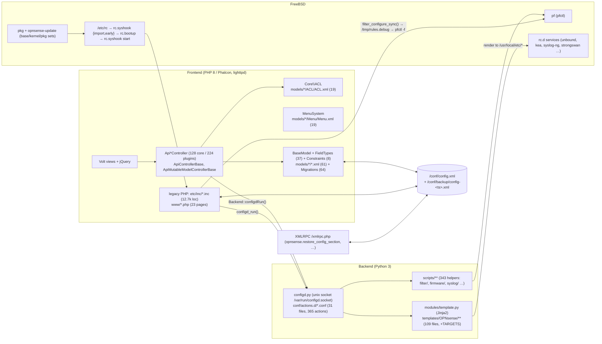
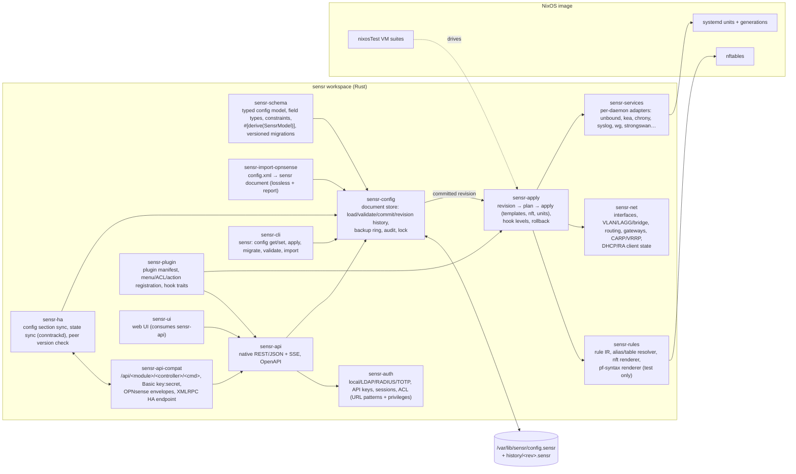

# 02 — OPNsense architecture evaluation and the sensr redesign

Status: research, 2026-11-15. Source of truth for citations: the reference clones in `reference/opnsense/`
(`scripts/fetch-reference.sh`, pins in `reference/REFS`) of
`opnsense/core` (8b88393, 26.7-series HEAD), `opnsense/plugins` (af4166a),
`opnsense/docs`, `opnsense/tools`, `opnsense/changelog`. Paths below are relative
to the respective repository root (`core/` unless stated). sensr re-implements
behaviour; nothing in this document proposes porting or copying OPNsense code
(BSD-2 for core, but we want a clean MIT codebase and a Rust-native design).

## 0. Executive judgement

OPNsense is two systems glued together:

| Layer | Technology | Where | Verdict |
|---|---|---|---|
| Configuration + API + UI | PHP 8 / Phalcon MVC, XML-described models | `src/opnsense/mvc/` (61 model XMLs, 128 core API controllers, 224 plugin API controllers) | Concepts are excellent: single config document, declarative typed models, versioned per-model migrations, URL-pattern ACLs, pluggable menu. Implementation is string-typed PHP with reflection and global singletons. |
| Legacy orchestration | PHP "inc" files + rc scripts | `src/etc/inc/*.inc` (12,694 lines; `interfaces.inc` alone 4,150), `src/etc/rc.*` | The part OPNsense has been removing for ten years. Still owns interface bring-up, boot order, pf ruleset assembly (`filter.inc`, `filter.lib.inc`), HA sync. Must not be reproduced as-is. |
| Backend service | Python 3 `configd` + Jinja2 templates + 343 helper scripts | `src/opnsense/service/`, `src/opnsense/scripts/` | The idea (privilege boundary, declarative action registry, template → file projection) is right; the realization (ini-defined shell commands, `%s` parameter splicing, 365 actions, untyped output) is where most operational fragility lives. |
| Packaging / firmware | FreeBSD pkg + `opnsense-update` sets + `rc.syshook.d` | `Makefile`, `Mk/*.mk`, `src/etc/rc.syshook.d/` | Replace wholesale with NixOS generations; keep the *hook levels* (`early`, `start`, `stop`, `update`, `upgrade`, `config`, `carp`, `monitor`, `import`) as a documented lifecycle contract. |

Design decisions for sensr that fall out of this evaluation:

1. **One typed configuration document** (`sensr-config`), serialized as our own
   schema (CBOR/JSON with a text form), *not* XML, but with a lossless
   `config.xml` importer. The OPNsense property we keep is "one file, one
   revision history, atomic save, every subsystem derives state from it".
2. **Models are Rust types, not XML.** The XML model language
   (`<field type="…"><Required>Y</Required>…`) is really a schema DSL with ~37
   field types and 8 constraint kinds. In Rust this is `serde` + a `#[derive(SensrModel)]`
   macro that yields the same artifacts OPNsense derives at runtime by
   reflection: validation, defaults, UI/API metadata, migrations index.
3. **Versioned per-module migrations survive**, as pure functions
   `fn migrate(v_old: Value) -> Result<Value>` chained by semver, exactly the
   contract `BaseModel::runMigrations()` implements, but executed once at load
   time and tested by round-trip corpora rather than on every boot.
4. **The configd role becomes a typed in-process actor** (`sensr-apply`) that
   turns a committed config revision into a *plan* (files to render, nftables
   ruleset, systemd units to restart) and applies it. Templates stay (minijinja),
   but outputs are declared, diffable, and testable as golden files.
5. **API compatibility is a façade crate** (`sensr-api-compat`) that speaks
   `/api/<module>/<controller>/<command>` with `key:secret` Basic auth and the
   `{result, validations, uuid}` envelopes, mapped onto the native sensr API.
   This is what makes `terraform-provider-opnsense`, `oapi`-style clients and
   Ansible collections work unchanged.
6. **pf → nftables** is the one place where "same behaviour" cannot mean
   "same text". The FilterRule/NAT rendering pipeline becomes an intermediate
   rule IR with two renderers (nftables for production, a pf-syntax renderer for
   *differential testing* against OPNsense fixtures).

## 1. Component diagram

### 1.1 OPNsense as built

### 1.2 sensr proposed

## 2. Area-by-area evaluation

Each subsection: **what it is**, **keep**, **pain** (with concrete files),
**sensr equivalent**.

### 2.1 `config.xml` as the single source of truth

**What it is.** `/conf/config.xml`, root `<opnsense>`, legacy top-level
sections (`system`, `interfaces`, `filter`, `nat`, `dnsmasq`, `unbound`,
`ntpd`, `rrd`, `theme`, `trigger_initial_wizard` in `src/etc/config.xml.sample`)
plus the MVC namespace `<OPNsense><Module><Model version="x.y.z" persisted_at="…">`.
Access is through a process-wide singleton `OPNsense\Core\Config`
(`src/opnsense/mvc/app/library/OPNsense/Core/Config.php`, 830 lines): `load()`
opens the file `r+` and keeps the handle; `lock()`/`unlock()` are `flock`;
`save()` rewrites the whole document under `LOCK_EX`, updates `<revision>`
(username, time, description, `impersonated_by`, `user_apitoken`), writes a
backup copy `/conf/backup/config-<microtime>.xml`, emits an `audit` syslog line
and a `config-event: new_config` syslog line that configd turns into the
`rc.syshook config` hook (`scripts/system/trigger_config_changed_events.py`).
`backupCount()` defaults to 100 and `cleanupBackups()` prunes.

The legacy side mirrors the same file into a global PHP array `$config`
(`etc/inc/config.inc: parse_config()`, `write_config()`), with
`listtags()` declaring which tags are always lists. `write_config()` calls
`Config::fromArray($config)` and then `toArray(listtags())` back — two
in-memory representations of one file in one process.

**Keep.** One document, atomic replace, per-save revision metadata, backup
ring with configurable depth, audit log on save, "config changed" event that
drives hooks, readable text form that admins diff and restore. Also the
`persisted_at` attribute used as a cache key (`BaseModel::persistedAt()`).

**Pain.**
- Two representations (`SimpleXMLElement` + `$config` array) and the
  `listtags()` heuristic to know whether `<rule>` is one or many
  (`etc/inc/config.inc:80`). XML cannot express arrays; every consumer
  re-derives it.
- No schema for the legacy sections; MVC models are validated, legacy ones are
  whatever PHP wrote. `ConfigMaintenance.php` exists only to find "unknown"
  nodes.
- Whole-document rewrite per save; `hasChanged()` is an mtime check.
- Secrets (passwords, API secrets, PSKs) live in the same file as everything
  else; backups copy them around in cleartext unless the Backup provider
  encrypts (`library/OPNsense/Backup/Base.php: encrypt()` – AES-256-CBC with a
  home-grown header).

**sensr equivalent.** Crate `sensr-config`:
- `Document` = strongly typed root struct generated from `sensr-schema`, stored
  as canonical JSON (text, diffable, `git`-friendly) with a `.sensr` extension
  and a header `{schema_version, revision{…}}`. CBOR is an option for the API
  but the on-disk form must stay human-readable: operators diff backups.
- `Store::commit(tx)`: validate → write `history/<rev>.sensr` → atomic rename
  into place → fsync → emit `RevisionCommitted` on an in-process bus. History
  ring size from `system.backup_count` (default 100 as OPNsense). Revision
  metadata exactly mirrors OPNsense's (`username`, `time`, `description`,
  `impersonated_by`, `user_apitoken`) so the compat API can return it for
  `core/backup/backups`.
- Separate `secrets` sub-document with the same revision semantics but a
  different file mode and optional sops/age encryption; backups can exclude it.
- `sensr config diff <rev1> <rev2>` reproduces `core/backup/diff`.

### 2.2 MVC models: XML definitions, field types, constraints, migrations

**What it is.** A model is a PHP class extending `OPNsense\Base\BaseModel`
plus a sibling `.xml` (`<model><mount>//OPNsense/Firewall/Filter</mount>
<version>1.1.7</version><migration_prefix>MFP</migration_prefix><items>…`).
`BaseModel::__construct()` (`models/OPNsense/Base/BaseModel.php:451`) loads the
XML, xpath-selects the mount point in config.xml, and `parseXml()` instantiates
one `FieldTypes/*Field` object per node. 37 field types live in
`models/OPNsense/Base/FieldTypes/` (TextField, IntegerField, BooleanField,
NetworkField, PortField, ProtocolField, HostnameField, EmailField, UrlField,
MacAddressField, CSVListField, OptionField, ModelRelationField,
InterfaceField, NetworkAliasField, CertificateField, AuthGroupField,
AuthenticationServerField, VirtualIPField, CountryField, AutoNumberField,
UniqueIdField, Base64Field, JsonField, JsonKeyValueStoreField,
ConfigdActionsField, LegacyLinkField, UpdateOnlyTextField, StrictTextField,
DescriptionField, ArrayField, ContainerField, …). Per-module custom field
types extend them (`models/OPNsense/Firewall/FieldTypes/*`, 18 files).
Constraints (`Base/Constraints/`): Unique, ComparedToField, Depend, Set,
SetIf, SingleSelect, AllOrNone. Validation is Phalcon's `Validation` with
`BaseValidator` subclasses; messages are keyed by `ref` (dotted path with
uuid) and returned to the API as `validations: {"rule.source_net": "…"}`.

Migrations: `Migrations/<prefix><ver>.php` extending `BaseModelMigration`
(`run($model)` then `post($model)`); `runMigrations()` (`BaseModel.php:882`)
globs the directory, sorts by `version_compare`, runs every migration between
the stored `version` attribute and the model's declared version, then
serializes once. `pluginctl -m` / `-M` runs all models' migrations
(`mvc/script/run_migrations.php`); `rc.bootup` → `convert_config()` runs it on
every boot. 64 core + 35 plugin migration classes exist. A typical one
(`Firewall/Migrations/MFP1_1_7.php`) copies legacy `<system>` scalars into the
MVC `Filter.settings` tree and deletes them in `post()` — i.e. migrations are
also the mechanism for moving legacy sections into typed models.

**Keep.**
- Declarative schema with rich network-aware field types, defaults, `Required`,
  `Multiple`, `Mask`, `ChangeCase`, `BlankDesc`, `volatile="true"` (runtime-only
  fields such as alias counters in `Firewall/Alias.xml`).
- Cross-field constraints as named, message-carrying objects.
- Relation fields (`ModelRelationField` with `<Model><source>…<items>…<display>…`)
  that validate referential integrity by uuid.
- Per-model semantic version + ordered migrations + run-at-boot + `post()` for
  cleanup, and `make lint-model` rules that enforce schema hygiene
  (`Mk/lint.mk: lint-model`).
- UUID-keyed array items (`ArrayField`), which is what makes the API stable.

**Pain.**
- Everything is a string. `BaseField::getValue(): string` — integers,
  booleans, lists are all text (`"1"`, `"a,b,c"`). Comparisons like
  `ComparedToFieldConstraint` do numeric coercion themselves.
- Reflection-driven: `getModelXML()` finds the XML by the *PHP file name*,
  migrations are located by directory glob and a `/mvc/app/models` path split
  (`BaseModel.php:912-919`, with a special case for tests).
- Model classes are mostly empty shells; real validation logic hides in
  field types (`Firewall/FieldTypes/FilterRuleField.php`) or `performValidation()`
  overrides, so "what is a valid rule" is spread over XML, PHP and
  `filter.lib.inc`.
- `isLegacyMapper()` (mount ends with `+`) models (Interfaces, Routes…) read
  legacy sections in place with no version attribute, so they cannot migrate.
- Migrations mutate `Config::getInstance()->object()` directly (raw
  SimpleXML), i.e. untyped against untyped; failures leave a half-migrated
  version pointer (`BaseModel.php:937-940`).
- No schema export; the API docs repo scrapes controllers
  (`docs/collect_api_endpoints.py`) rather than reading a schema.

**sensr equivalent.** Crate `sensr-schema`:
- Field types become newtypes with `FromStr/Display/Serialize/Deserialize`
  and a `FieldMeta` const (ui label, help, blank description, multiplicity):
  `Port`, `PortRange`, `Protocol`, `Ipv4Net`, `Ipv6Net`, `NetOrAlias`,
  `Hostname{dns,wildcard,zone_root}`, `MacAddr`, `Email`, `Url`, `Country`,
  `Base64`, `Uuid`, `InterfaceRef`, `GatewayRef`, `CertRef`, `AliasRef`,
  `AuthServerRef`, `GroupRef`, `VipRef`, `Relation<T>`, `Csv<T>`, `Json<T>`,
  `AutoNumber`, `UpdateOnly<T>`. Each carries the exact acceptance rules the
  OPNsense PHPUnit suite pins down (see 03-test-parity.md, T-0001…).
- `#[derive(SensrModel)]` on structs/enums generates: default application,
  `validate(&self, ctx) -> Validations` (dotted-path keyed, OPNsense-compatible
  message map), `constraints![Unique(name), SetIf(type == dynipv6host => interface), …]`
  attribute macros, UI/API metadata (JSON Schema + x-sensr extensions), and a
  `SCHEMA_VERSION: semver`.
- `Relation<T>` resolution and `Unique`/`Depend`/`AllOrNone`/`SingleSelect`/
  `SetConstraint`/`SetIf`/`ComparedToField` are first-class in a
  `sensr_schema::constraints` module with property tests.
- Migrations: `trait Migration { const FROM: Version; const TO: Version;
  fn run(doc: &mut serde_json::Value) -> Result<()>; fn post(doc: &mut Value) }`
  registered per module with `inventory`; `sensr-config` runs the chain at
  load, in a transaction, and refuses to start on a failed step (no
  half-migrated state). Every migration ships with a `before.json`/`after.json`
  golden pair.
- Volatile/runtime fields are *not* in the schema; they live in a separate
  `State` overlay served by the API (`sensr-api` merges them for compat).

### 2.3 Legacy `/etc/inc` PHP layer vs MVC

**What it is.** `src/etc/inc/`: `config.inc`, `util.inc`, `system.inc`,
`interfaces.inc` (4,150 lines), `interfaces.lib.inc`, `filter.inc`,
`filter.lib.inc`, `auth.inc`, `certs.inc`, `console.inc`, `plugins.inc`,
`plugins.inc.d/*.inc` (24 files), `legacy_bindings.inc`,
`XMLRPC_Client.inc`, `IPv6.inc`, `rrd.inc`. 23 legacy pages remain under
`src/www/*.php` (interfaces.php, system_general.php, firewall_schedule*,
services_ntpd*, diag_backup.php, xmlrpc.php, …). `legacy_bindings.inc` is the
bridge (`configd_run()`, `legacy_firewall_model()`).

**Keep.** The *function-per-concern* decomposition that `plugins.inc.d` arrived
at (`<name>_services()`, `_configure()`, `_syslog()`, `_xmlrpc_sync()`,
`_interfaces()`, `_devices()`, `_firewall($fw)`, `_cron()`, `_run()`) — this
is the de-facto plugin trait surface and is worth formalizing (see 2.7).

**Pain.**
- `interfaces.inc` does device creation, address assignment, PPP, 6rd/6to4,
  track6, bridges, wireless and gateway monitoring in one global-state file;
  `system.inc` owns kernel tunables, resolver, syslog, trust store, hostname.
- Global `$config` array mutation plus `write_config()` from anywhere, so the
  "single source of truth" is write-shared by hundreds of functions.
- The boot path (`rc.bootup`) calls `filter_configure_sync()` three times to
  get ordering right.
- Shell-outs via `mwexecf()`/`shell_safe()` everywhere; `make lint-exec` exists
  purely to grep for forbidden `exec(`/`system(` uses.

**sensr equivalent.** There is no legacy layer. `sensr-net` (interfaces,
routing, gateways, CARP/VRRP via keepalived or our own VRRP), `sensr-services`
(one adapter module per daemon) and `sensr-apply` (orchestration) take over
everything `/etc/inc` does, with netlink (`rtnetlink` crate) instead of
`ifconfig` parsing and systemd D-Bus instead of `rc.d`. The remaining 23 PHP
pages have MVC-less semantics that must be re-specified from behaviour
(interface assignment wizard, backup/restore page, NTP GPS/PPS).

### 2.4 configd: actions and templates

**What it is.** `src/opnsense/service/configd.py` daemonizes
`modules.processhandler.Handler`, listening on `/var/run/configd.socket`.
Protocol (`processhandler.py:153-225`, `library/OPNsense/Core/Backend.php`):
client writes a line, optional prelude chars `&` (detach), `!` (flush cache);
server shlex-splits it, resolves `actions.d` entry `[section]` under file
`actions_<module>.conf` to a dotted command (`filter reload`,
`template reload OPNsense/Syslog`), checks `is_allowed(session)` via peer
credentials (`xucred`), executes, and replies with text terminated by
`\0\0\0`; "Execute error" / "Action not allowed or missing" are stringly
typed. Action types (`modules/actions/`): `script`, `script_output`
(cacheable with `cache_ttl`), `stream_output`, `inline` (python functions
`template.reload|cleanup|list`), `none`. 31 action files, 365 actions in core;
every plugin adds its own (`plugins/dns/ddclient/src/opnsense/service/conf/actions.d/actions_ddclient.conf`).
Parameters are spliced into the command with `%s` (`actions_filter.conf:
parameters: --filter=%s --limit=%s …`) after `escapeshellarg` on the PHP side.

Templates: `templates/OPNsense/<Module>/` with Jinja2 files and a `+TARGETS`
manifest `source:destination` (e.g. `Syslog/+TARGETS:
syslog-ng.conf:/usr/local/etc/syslog-ng.conf`), rendered by
`modules/template.py: Template.generate(module)` with the whole config.xml as
an `OrderedDict` context plus helpers (`helpers.glob`, `physical_interface`,
`exists`). Filename patterns can expand per list item (`[name]` in +TARGETS).
A `template reload *` renders everything on boot (`rc.syshook.d/early/15-templates`).

**Keep.**
- The privilege boundary: web user → unix socket → root daemon with an
  allow-list of named actions and per-action access control.
- Named actions with human `message:` (used for the audit/notice log) and
  `description:` (used for the ConfigdActionsField in cron).
- Output caching (`cache_ttl`), streaming (`stream_output` for `pftop`, logs).
- Template → file projection with an explicit target manifest; templates have
  read access to the full config.
- `configctl` CLI parity: `configctl filter reload`.

**Pain.**
- Actions are ini-defined shell command lines; return type is "whatever stdout
  was", so every PHP caller `json_decode`s and guesses. There is no schema for
  inputs or outputs (`Backend::configdpRun()` returns `string`).
- `%s` parameter templating: the number and order of params is implicit; a
  wrong count silently yields a wrong command.
- `type:inline` python functions are a second plugin mechanism.
- Templates are rendered against the *raw* XML dict, so template authors
  re-implement model defaults and list-vs-single handling (`listtags` problem
  again). `test_sample` in `service/tests/template.py` references a template
  directory that no longer exists.
- The daemon restarts itself in a watch loop (`run_watch()`); failures are
  observable only via syslog.

**sensr equivalent.** Crate `sensr-apply`:
- No socket protocol between UI and backend: `sensr-api` and `sensr-apply` are
  modules in one `sensrd` process (or, if we want a privilege split, a
  `varlink`/D-Bus-style typed IPC with generated clients — decision deferred
  to the security design doc). Actions become `enum Action` variants with typed
  parameters and typed results (`Result<serde_json::Value, ActionError>`),
  registered in an `ActionRegistry` with name, description, required
  privilege, cacheability, streaming flag. `sensr action run filter.reload`
  gives `configctl` parity, and `sensr-api-compat` exposes
  `core/service/*`, `firewall/filter/apply`, etc. onto it.
- Templates: `minijinja` with the *typed* document (serde to Value) as
  context and the same helper names (`glob`, `physical_interface`, `exists`) so
  template knowledge transfers; a `Targets` struct replaces `+TARGETS`. Every
  template has a golden-file test (rendered output for a fixture document).
- Apply is planned: `Plan { files: Vec<FileChange>, nft: Ruleset,
  units: Vec<UnitAction>, hooks: Vec<Hook> }`; `sensr apply --dry-run`
  prints it; application is transactional per service with rollback to the
  previous rendered set on failure. This is the piece OPNsense lacks entirely
  (`rc.filter_configure` writes `/tmp/rules.debug` and calls `pfctl -f`, errors
  go to `/tmp/rules.error`).

### 2.5 REST API and authentication

**What it is.** Routes are `/api/<module>/<controller>/<command>[/<p1>/…]`
(`docs/source/development/api.rst`). Controllers extend
`ApiControllerBase` (`controllers/OPNsense/Base/ApiControllerBase.php`);
`beforeExecuteRoute()` distinguishes external clients by presence of an
`Authorization` header: `Basic base64(key:secret)` → `AuthenticationFactory
->get("Local API")` (`library/OPNsense/Auth/API.php`: `password_verify` on
the stored secret hash, checks `disabled`/`expires`) → `ACL::isPageAccessible
(username, REQUEST_URI)` → 401/403 JSON bodies; else session + CSRF header
`X-CSRFToken`. `afterExecuteRoute()` JSON-encodes array returns. Mutable model
controllers (`ApiMutableModelControllerBase`) implement the generic CRUD
contract: `search<Item>` (POST `{current,rowCount,sort,searchPhrase}` →
`{total,rowCount,current,rows}`), `get<Item>/<uuid>` (returns `{item: {…}}`
with option fields expanded to `{value: {value, selected}}` maps),
`add<Item>`, `set<Item>/<uuid>`, `del<Item>/<uuid>`, `toggle<Item>/<uuid>`
→ `{result: "saved"|"deleted"|"failed", validations: {...}, uuid}`;
`ApiMutableServiceControllerBase` gives `start/stop/restart/reconfigure/status`.
API keys are per user (`system.user.apikeys.item{key,secret}`; secret stored
hashed; created via `createKey()`), and the revision context records
`user_apitoken`.

**Keep.** The URL shape and the envelopes — they are the interoperability
contract (Terraform provider `browningluke/terraform-provider-opnsense`,
Ansible `puzzle.opnsense`, Home Assistant, `oPNsense-cli` etc. all hard-code
`search*/get*/add*/set*/del*/toggle*` and the `{result,validations,uuid}`
shape). Key/secret Basic auth with per-key ACL. `X-CSRFToken` for browser
sessions. `ACL` applied to API paths with wildcards.

**Pain.**
- No OpenAPI; `docs/collect_api_endpoints.py` scrapes method names to produce
  docs, so types/params are undocumented ("open the browser inspector",
  `api.rst`).
- Only `GET` and `POST`. Everything mutating is POST; deletes are POST.
- Option fields are returned as the full option set with `selected` flags,
  which makes `get*` responses O(options) and clients write special code to
  pick the selected value.
- Error payloads vary: `{status:401,message}` vs `{result:"failed",
  validations}` vs HTML on uncaught exceptions.
- API keys are stored in config.xml next to the user with a bcrypt hash; fine,
  but rotation/expiry only via user `expires`.

**sensr equivalent.**
- `sensr-api`: native, versioned, OpenAPI-first (`utoipa`), JSON Schema derived
  from `sensr-schema`, proper verbs, ETag/If-Match on documents, SSE for
  streaming (`stream_output` parity), bearer tokens + sessions.
- `sensr-api-compat`: an axum router mounted at `/api/` that implements the
  OPNsense module/controller/command grammar for every endpoint the
  compatibility matrix lists (start: `core/firmware/*`, `core/backup/*`,
  `core/service/*`, `firewall/alias/*`, `firewall/alias_util/*`,
  `firewall/filter/*`, `firewall/source_nat/*`, `firewall/d_nat/*` (and the
  older `firewall/nat/*`), `firewall/category/*`, `firewall/group/*`,
  `interfaces/vlan_settings/*`, `interfaces/overview/*`, `routes/routes/*`,
  `routing/settings/*`, `unbound/settings/*`, `unbound/service/*`,
  `kea/dhcpv4/*`, `kea/leases4/*`, `dnsmasq/*`, `wireguard/*`, `ipsec/*`,
  `openvpn/*`, `trust/*`, `auth/user/*`, `auth/group/*`, `diagnostics/*`).
  Request/response shapes are generated from a mapping table
  (`compat/endpoints.toml`) plus hand-written adapters; the option-set
  `{value,selected}` expansion is reproduced from field metadata. Basic
  `key:secret` auth is honoured; keys imported from `config.xml` keep working
  because we store the same bcrypt hashes.
- Compatibility tests record real OPNsense responses (from an OPNsense VM in
  the lab or from the upstream API docs examples) as golden JSON and replay
  them against sensr (see 03-test-parity.md §4.4).

### 2.6 ACL and privileges

**What it is.** `models/OPNsense/Core/ACL.php` merges `ACL/ACL.xml` from every
module (`mergePluggableACLs()`), each entry `page-<x>` with `<name>` and
`<patterns><pattern>ui/firewall/filter/*</pattern><pattern>api/firewall/filter/*</pattern>`;
plus legacy `<match>` entries. Users and groups carry `<priv>` lists in
`system.user`/`system.group`; groups may have `source_networks` restricting
where privileges apply (`isAddressAllowed()`). `urlMatch()` turns patterns into
regexes (`*` → `.*`). Special privileges: `page-all`, `user-config-readonly`,
`user-shell-access`, landing page. Result is cached in
`/tmp/opnsense_acl_cache.json`. `Scripts/dashboard-acl.sh` lints that every
dashboard widget's endpoints are covered by an ACL pattern.

**Keep.** Privilege = named bundle of URL patterns; group-level source network
restriction; `page-all` and `user-config-readonly` semantics; API and UI share
one ACL. Lint that every endpoint is covered by some privilege.

**Pain.** URL-pattern matching as the *only* authorization primitive means
authorization is coupled to routing text; a renamed controller silently
changes access. Caching to a world-readable temp JSON. Patterns live in XML
far from the controllers they protect.

**sensr equivalent.** `sensr-auth::acl`: privileges are declared next to the
handlers (`#[privilege("page-firewall-rules")]`) and *also* exported as the
legacy pattern list so the compat layer can answer `isPageAccessible()` the
same way for `/api/...` paths and so imported `<priv>` lists keep meaning.
Source-network constraints, `page-all`, read-only and shell-access flags are
kept as-is. A build-time test asserts every compat route maps to a privilege
(this replaces `dashboard-acl.sh`).

### 2.7 Plugin system

**What it is.** Plugins are FreeBSD packages `os-<name>` built from
`plugins/<category>/<name>/{Makefile,pkg-descr,src/}` with `Mk/plugins.mk`
(variables `PLUGIN_NAME/VERSION/DEPENDS/COMMENT/MAINTAINER/TIER/CONFLICTS`,
auto-generated `+POST_INSTALL` hooks). 102 plugins in the repo. A plugin
contributes by *dropping files into known directories*:
`src/opnsense/mvc/app/{models,controllers,views}/OPNsense/<Module>/…`
(models, `ACL/ACL.xml`, `Menu/Menu.xml`, `Migrations`),
`src/opnsense/service/conf/actions.d/actions_<name>.conf`,
`src/opnsense/service/templates/OPNsense/<Name>/`, `src/etc/inc/plugins.inc.d/<name>.inc`
(hook functions `<name>_services|configure|syslog|xmlrpc_sync|interfaces|devices|firewall|cron|run`),
`src/etc/rc.d/<name>`, `src/etc/rc.syshook.d/<level>/NN-<name>`,
`src/etc/rc.loader.d/`, `src/opnsense/www/js/widgets/*.js` + `Metadata/*.xml`
(dashboard), `src/opnsense/scripts/<name>/`. `plugins.inc: plugins_scan()`
globs `plugins.inc.d`; `plugins_configure($hook)` dispatches hooks (`early`,
`dhcp`, `dns`, `monitor`, `vpn`, `bootup`, `newwanip`, `crl`, …) by calling
`<name>_configure()` which returns `[hook => [callable, …]]`. `rc.syshook
<level>` runs every executable in `rc.syshook.d/<level>/` in order
(`early/05-upgrade … 99-selftest`, `start/10-newwanip … 95-beep`,
`stop/`, `update/10-refresh.sh`, `upgrade/10-sanity.sh`, `config/`, `carp/`,
`monitor/20-recover`, `import/20-importer`). Plugin templates for scaffolding
live in `plugins/Templates/`.

**Keep.** Everything a plugin can contribute is a *declared artifact*: model,
menu, ACL, actions, templates, syslog facility, HA sync section, service
descriptor (name/pidfile/configd start/stop/restart), firewall rules via
`_firewall($fw)`, interfaces/devices, cron jobs, hooks by level. The
`pkg-descr` changelog convention and `PLUGIN_TIER`.

**Pain.** Contribution by filesystem convention with no manifest: a plugin's
surface is discovered by `glob` at runtime (`plugins_scan`,
`mergePluggableACLs`, `MenuSystem::addXML`, configd action load), and
removal is `pkg delete` plus hoping the config section is ignored. PHP and
Python code run as the web user and as root respectively, with no isolation.
Core knows about plugins by name (`CORE_CONFLICTS`, `plugins_run('dhcrelay_interfaces')`).

**sensr equivalent.** `sensr-plugin`: a `Plugin` trait (`fn manifest() ->
Manifest { name, version, tier, menu, acl, actions, templates, syslog,
ha_sections, services, hooks }`) with two delivery modes: (a) compiled-in
crates behind Cargo features for first-party plugins (what OPNsense calls
core-adjacent plugins: wireguard, kea, unbound, dnsmasq, ipsec, openvpn, ids,
ddclient, haproxy, nginx, acme…), (b) out-of-tree plugins as NixOS modules
that register a manifest file and a separate binary speaking the typed action
IPC (sandboxable). The OPNsense hook levels become `enum HookLevel` events on
the `sensr-apply` bus; `rc.syshook.d`-style executable scripts remain
supported for operator drop-ins at `/etc/sensr/hooks/<level>/`.

### 2.8 Firmware/update and boot sequence

**What it is.** Boot: FreeBSD `/etc/rc` is replaced by `src/etc/rc`:
recover base → `rc.syshook import` → var/tmp setup → PHP setup
(`rc.subr.d/php`) → `rc.syshook early` (`05-upgrade` applies pending
`opnsense-update -K/-B/-P` sets and reboots, `10-configd` starts configd,
`15-templates` renders all templates, `90-carp`, `99-selftest` integrity
checks) → `rc.bootup` (PHP: `convert_config()` i.e. migrations, devd, login,
interface mismatch prompt, loopback, kernel/sysctl/timezone/firmware/trust/
hostname/resolver/syslog, `filter_configure_sync()` default policy, hardware,
`interfaces_configure()`, `filter_configure_sync()`, `plugins_configure('early')`,
routing, `plugins_configure('dhcp'|'dns')`, filter again, `monitor`, `vpn`,
`bootup`) → `rc.syshook start`. Firmware: `scripts/firmware/*.sh` wrap `pkg`
and `opnsense-update` (sets `base`, `kernel`, `pkg`), with `lock.sh`,
`health.sh` (mtree verification of base/kernel against signed `.mtree`),
`audit`, `changelog.sh`, `reboot.sh`; `Core/Api/FirmwareController.php`
exposes `status/check/update/upgrade/health/audit/install/remove/lock/unlock/
changelog/info/getOptions/set`. Firmware settings model `Core/Firmware.xml`
(mirror, flavour, type, subscription). The version file
`src/opnsense/version/core.in` carries product metadata the UI reads.

**Keep.** The ordered hook levels; an explicit "early/pending upgrade"
step; integrity selftest at boot; the firmware API surface (status, check,
changelog, health, audit) because dashboards and Ansible use it; the
`product_*` version JSON.

**Pain.** `rc.bootup` depends on PHP being up before the network exists; three
filter reloads to converge ordering; package-based upgrades with
`+POST_INSTALL` scripts and `pkg check -d` as the health model; no atomic
rollback except ZFS boot environments (`SnapshotsController`).

**sensr equivalent.** NixOS does the heavy lifting: boot ordering is
systemd targets (`sensr-config.target` → `sensr-net.target` →
`sensr-apply.service` → `sensr-services.target`), upgrades are generations
with rollback, integrity is the Nix store (plus `systemd-verity` for the
image). `sensr-apply` implements the hook-level contract. The compat
`core/firmware/*` endpoints map onto `nixos-rebuild`-style channel operations
(`status` = current generation + available channel version, `update/upgrade`
= switch to new closure, `health` = store verification + unit status,
`changelog` = our CHANGELOG). Pi images (`opnsense-pi` lineage) are first
class: `vm/test.sh`-style QEMU boot tests are part of CI.

### 2.9 Filter rule generation (pf) → nftables

**What it is.** `etc/inc/filter.inc: filter_configure_sync()` builds the
ruleset in memory: flush alias cache, lock `/tmp/rules.debug`, shaper
kickstart, `ifgroup_setup()`, create `\OPNsense\Firewall\Plugin` (`library/
OPNsense/Firewall/Plugin.php`) with interface mapping and gateway mapping,
`filter_core_bootstrap()` registers system rules (`filter.lib.inc:
filter_core_rules_system()` — block IPv6 when disabled, default deny, RFC4890
ICMPv6, bogons, anti-lockout, DHCP, CARP, sshlockout/virusprot tables…),
`plugins_firewall($fw)` lets plugins add rules, `filter_core_rules_user()`
registers user rules from the MVC `Filter` model, NAT rules
(`registerSourceNatRule/DestinationNatRule/ForwardRule/NptRule`), then text is
assembled: `filter_generate_aliases()` (pf `table <name> persist` and
`name = "<name>"` macros, port aliases as `{ ports }` lists) + `tablesToText()`,
`set limit/optimization/timeout`, scrub, NAT, filter rules (`outputFilterRules()`
sorted by priority), and `pfctl -f`. Rule objects: `Rule.php` provides the
cartesian expansion (`reader()`: interfaces × received-on × from × to ×
ipprotocol incl. `inet46`), address/alias/interface-net mapping
(`mapAddressInfo`), and `ruleToText()` driven by an ordered `procorder` table;
`FilterRule.php` defines `procorder` (`disabled type direction log quick
interface gateway reply ipprotocol protocol from from_port os to to_port scrub
received-on icmp-type icmp6-type flags state max-pkt-rate set-prio prio tos tag
tagged allowopts dn divert-to label descr`) and the normalisations in
`parseFilterRules()` (reply-to derivation, gateway-down disabling, TCP flags,
state options incl. `max-src-conn-rate … overload <virusprot> flush global`,
ICMP/ICMPv6 type switching, shaper `dnpipe/dnqueue`). `Util::calcRuleHash()`
produces the stable `label` used for log → rule lookup
(`scripts/filter/list_rule_ids.py`, `read_log.py`).

**Keep.** The *pipeline*: config → typed rule objects → normalisation →
priority-sorted registration (system rules prio 1, plugins, user rules, NAT at
100/200/300/600) → text → atomic load; rule origin tracking; stable rule
label/hash for log correlation; interface-group and `(self)`/`<if>ip`/`<if>net`
pseudo-addresses; alias indirection; the `#ref` back-link from generated rules
to UI pages; the fixture-driven rendering tests
(`mvc/tests/app/library/OPNsense/Firewall/FilterRuleTest/*.conf`).

**Pain.** The pipeline is half legacy PHP (`filter.inc`, `filter.lib.inc`
702 lines of hand-written rule dicts), half MVC library, and the output is
a flat pf text file whose correctness is only known at `pfctl -f` time.
pf-specific semantics are baked into field names (`statetype`, `nopfsync`,
`reply-to`, `route-to`, `divert-to`, `dn`, `tag/tagged`, `set prio`,
`allowopts`, `os` fingerprinting). Floating rules with `quick` default
inversion. No dry-run or diff.

**sensr equivalent.** `sensr-rules`:
- IR: `Ruleset { tables: Vec<Table>, chains: Vec<Chain>, rules: Vec<Rule> }`
  with `Rule { origin, prio, action: Pass|Block|Reject, dir, iface(s),
  family: V4|V6|Both, proto, src: MatchAddr, dst, ports, icmp types, state:
  StatePolicy{keep|modulate|synproxy|none, limits…}, log, quick, gateway
  (policy routing → `fwmark` + routing tables), reply_to (→ `ct mark`/`fib`),
  tos/dscp, tag/tagged (→ `meta mark`/`ct mark`), set_prio (→ `meta priority`),
  shaper (→ tc/`nftables` queue/`meta mark` into tc classes), label }`.
- Renderer `nft`: emits an `nft -f` script with a `table inet sensr`,
  per-interface base chains, `set`s for aliases (`type ipv4_addr; flags
  interval`), `log prefix "<label>"`. Semantics table documenting each pf
  keyword's nftables mapping and which are *not* representable (pf `os`
  fingerprinting, `scrub` reassembly options beyond `nf_defrag`, `synproxy`
  maps to nft `synproxy`; `modulate state` has no equivalent and becomes
  `keep`). Apply via `nft -c` (check) then `nft -f` atomically; `nft list
  ruleset` diff for `--dry-run`.
- Renderer `pf-text` (test-only): emits OPNsense-style pf lines from the same
  IR so that the three upstream fixtures and our own extended corpus become
  *differential* tests: parse OPNsense rule dicts → IR → pf text must equal
  fixture; IR → nft must equal our golden `.nft`.
- Default system rules (`filter_core_rules_system`) are re-specified as data
  (`system_rules.toml`) with golden output for both renderers.

### 2.10 Aliases: pf tables, URL tables, GeoIP

**What it is.** Model `Firewall/Alias.xml` (types `host network port url
urltable urljson geoip networkgroup mac asn dynipv6host authgroup internal
external`; fields `proto`, `interface`, `counters`, `updatefreq`, `content`,
`username/password/authtype`, `expire`, `path_expression`, `categories`,
volatile counters). Rendering: `filter_generate_aliases()` writes pf
`table <name> persist` + macro; contents are filled asynchronously by
`scripts/filter/update_tables.py` from `/usr/local/etc/filter_tables.conf`
(itself a Jinja template `templates/OPNsense/Filter/filter_tables.conf`) using
`lib/alias/` parsers: `base.BaseContentParser` (IPs, CIDRs, wildcard masks,
async DNS via dnspython for hostnames), `uri.UriParser` (URL/URL table/JSON
with `path_expression`, auth), `geoip.GEOIP` (downloads `alias.stats` + per
country files), `bgpasn.BGPASN`, `arpcache.ArpCache` (MAC), `interface.InterfaceParser`
(dynamic IPv6 host), `auth.AuthGroup` (OpenVPN group), nested aliases via
`get_alias_deps()`; results cached in `/var/db/aliastables/<name>.txt` with a
hash file for change detection; `PF.replace()` does `pfctl -t <name> -T replace -f`.
Port aliases are inlined as pf macros (`filter_core_get_port_alias()`),
empty port aliases become `0 <> 65535`. `Firewall/Alias.php` adds
`whereUsed()`/`refactor()` (rename propagation), `aliasIterator()` with
dynamic aliases (`DynamicAliases/*.php`: interface nets, captive portal zones,
static `core.json` aliases like `bogons`, `sshlockout`, `virusprot`).
Diagnostics API `firewall/alias_util/*` lists/flushes/adds entries.

**Keep.** Alias type taxonomy and the resolve-asynchronously-and-replace
model; dependency-aware nested resolution; TTL/`expire`/`updatefreq`
semantics; change-detection cache; counters; rename refactoring; dynamic
system aliases; `alias_util` API.

**Pain.** Two mechanisms (pf macros for ports vs tables for addresses);
resolution logic lives in Python called from cron and from PHP via configd
with text files as the hand-off; GeoIP source is a Maxmind/opnsense feed with
a stats side-file; `test_parse_*` tests need live network and root.

**sensr equivalent.** `sensr-rules::alias`: `enum AliasKind` identical to
OPNsense's; `Resolver` trait per kind with injectable fetchers (HTTP, DNS,
GeoIP DB, ARP via netlink neighbours, interface addresses) so tests are
hermetic; results become nftables named sets (`ipv4_addr`/`ipv6_addr`
intervals, `inet_service` for ports — so ports are sets too, no macros);
`nft add element` deltas instead of full replace where possible; per-alias
`AliasState { count, last_updated, hash }` in the state overlay for the
compat API's volatile fields. Nested aliases via a DAG with cycle detection
(property-tested).

### 2.11 Logging

**What it is.** syslog-ng configured from `templates/OPNsense/Syslog/`
(`syslog-ng.conf.in` includes `sources/*.conf`, `local/*.conf` filter
definitions per application — `filter.conf` matches program `filterlog`,
`firewall.conf`, `kea.conf`, …), destinations per facility under
`/var/log/<app>/<app>_<date>.log`, remote targets from `Syslog.xml`
(`destinations.destination`: transport, host, port, certificate, programs,
facilities, levels, `rfc5424`). Plugins register facilities via
`<name>_syslog()` returning `['facility' => [...]]`
(`plugins.inc: plugins_syslog()`), and templates `Syslog/local/<name>.conf`.
Reading: `Diagnostics/Api/LogController::__call` → `scripts/syslog/queryLog.py`
/`streamLog.py` (SSE), log formats in `scripts/syslog/logformats/`, firewall
log parsing `scripts/filter/read_log.py` (pf `filterlog` CSV → JSON with
rule label → description via `list_rule_ids.py`). Lockout handler for auth
failures (`scripts/syslog/lockout_handler`). Config changes are audited to
facility `audit`.

**Keep.** Per-application log files with structured query/stream API
(`diagnostics/log/<module>/<scope>` + `clear`), remote syslog destinations
with per-destination filters, audit facility, firewall log → rule
correlation, lockout on repeated auth failures.

**Pain.** Log *format* knowledge is in Python regexes per application; pf's
`filterlog` CSV format is FreeBSD-specific; syslog-ng as the only pipeline.

**sensr equivalent.** journald as the source of truth (`tracing` →
journald with structured fields: `SENSR_MODULE`, `SENSR_RULE_LABEL`,
`SENSR_AUDIT=1`); nftables `log` goes to `nflog` group consumed by a
`sensr-fwlog` task that emits structured records (replacing `read_log.py`);
optional syslog-ng/rsyslog forwarding rendered from the same `Syslog` model
(templates + golden tests) for remote destinations. The compat
`diagnostics/log/*` endpoints query journald with the same paging/filter
parameters and produce OPNsense's row shape.

### 2.12 Backup/restore and configuration history

**What it is.** Local history: `Config::backup()`/`getBackups()`/
`restoreBackup()`/`getBackupFilename()`, exposed by `Core/Api/BackupController`
(`providers`, `backups/<host>`, `diff/<host>/<b1>/<b2>` – a unified diff of
two XML revisions, `deleteBackup`, `revertBackup`, `download/<host>/<backup>`)
and by `www/diag_backup.php` (download with optional AES encryption, restore
whole or a single `<section>`, "reset to factory", "reinstall packages" flag).
Remote providers implement `IBackupProvider` (`library/OPNsense/Backup/`:
Local; plugins add Google Drive, Nextcloud, Git, S3…) and run on every save
via the `config` syshook. Legacy `restore_config_section` also exists for HA.

**Keep.** Revision list with metadata (`username`, `description`, `time`,
`version`, `filesize`), diff between revisions, revert, download, per-section
restore, encrypted exports with a documented container format, provider
plug-in interface triggered on each commit.

**Pain.** Backup = copy of the XML file, so history = N full copies; diff is
computed by shelling `diff`; encryption container is bespoke
(`Base::encrypt()`); restoring an older `config.xml` re-runs migrations on
boot only.

**sensr equivalent.** `sensr-config::history` (full revisions, content-addressed
and optionally compressed; diff computed structurally and rendered as both
JSON patch and unified text), `sensr-backup` with `BackupProvider` trait
(local, S3, git, WebDAV first), `age`-based encryption for exports *plus* a
reader for the OPNsense encrypted-backup format so an operator can migrate an
encrypted backup. Restore of an OPNsense `config.xml` goes through
`sensr-import-opnsense`; restore of a sensr revision re-runs migrations if
needed, immediately, with validation.

### 2.13 HA sync (XMLRPC + pfsync)

**What it is.** `Core/Hasync.xml` model (pfsync interface/peer/version,
`synchronizetoip`, `username/password`, `verifypeer`, `syncitems` populated by
configd `system ha options` from `plugins_xmlrpc_sync()` → each plugin's
`<name>_xmlrpc_sync()` returns `{id, description, section:
"OPNsense.DynDNS" | "system.user,system.group", services: [...]}`).
`rc.filter_synchronize` builds the partial config (`copy_conf_section()`,
`remove_nosync()`, VIP `advskew+100` adjustment) and calls the peer's
`/xmlrpc.php` (`XMLRPC_Client.inc`) methods `opnsense.firmware_version`,
`opnsense.restore_config_section`, then the peer restarts the listed
services; `Core/Api/HasyncStatusController` proxies `services/start/stop/
restart/restartAll` on the peer; `rc.syshook.d/carp/*` hooks react to CARP
state changes (`20-openvpn-instances`, `20-wireguard`, `20-dhcrelay`, `20-ppp`).
State sync is pf's `pfsync` (`pfsyncversion` 1301/1400/1500 for cross-release
compat).

**Keep.** Per-section opt-in sync list contributed by plugins; version check
before sync; `nosync` per-item flag; `advskew` bump for the backup; CARP
event hooks; remote service control.

**Pain.** XML-RPC with HTTP Basic auth and the *admin* credentials of the
peer, over HTTPS with `verifypeer` off by default; sections are copied as
arbitrary trees so schema mismatch between versions is only caught by the
version method; pfsync is pf-only.

**sensr equivalent.** `sensr-ha`: typed sync over the compat/ native API using
a dedicated HA API key with a `ha-sync` privilege (and still accepting
`opnsense.restore_config_section` XML-RPC on the compat side so a mixed
OPNsense→sensr migration window works); sections identified by schema module
with version negotiation; `nosync` kept; VRRP (keepalived or own impl) for
CARP semantics incl. `advskew`; `conntrackd` for state sync instead of
pfsync; CARP hook events → `HookLevel::Carp`.

### 2.14 Build, lint, test infrastructure (what the repo enforces)

`Makefile` (`core`) targets: `lint` (= `lint-plist lint-desc lint-shell
lint-xml lint-model lint-acl lint-class lint-import lint-exec lint-php`),
`style` (`pycodestyle --ignore=E501`, `phpcs --standard=ruleset.xml` PSR-12),
`sweep` (`cleanfile` whitespace normaliser, model XML canonicalisation,
`phpcbf`), `test` (phpunit in `src/opnsense/mvc/tests`), `migrate`
(`pluginctl -m`), `validate` (`pluginctl -v`, validates every non-volatile
model against the live config), `plist`/`plist-fix` (package file list),
`package`/`upgrade`. `tools/build/test.sh` runs `pkg check -da/-sa`, then
`make lint style test` for core and each plugin inside the build chroot; CI
is Jenkins/Buildbot-style on upstream infra (no `.github/workflows` in the
repo). Details and the full inventory are in 03-test-parity.md.

## 3. Crate map (first cut)

| Crate | Responsibility | OPNsense counterpart |
|---|---|---|
| `sensr-schema` | field types, constraints, `#[derive(SensrModel)]`, migrations registry, JSON Schema export | `Base/FieldTypes`, `Base/Constraints`, `BaseModel`, `*.xml` models, `Migrations/` |
| `sensr-config` | document store, revisions, history, locking, audit, events | `Core/Config.php`, `config.inc`, `BackupController` |
| `sensr-import-opnsense` | `config.xml` → sensr document, with per-node provenance and an import report | `convert_config()`, legacy mappers |
| `sensr-rules` | rule IR, alias resolver, nft renderer, pf-text test renderer, system rules | `Firewall/Plugin.php`, `Rule.php`, `FilterRule.php`, `*NatRule.php`, `filter.inc`, `filter.lib.inc`, `scripts/filter/lib/alias` |
| `sensr-net` | interfaces/VLAN/LAGG/bridge/PPP, addresses, routing, gateways+monitoring, VRRP | `interfaces.inc`, `Interfaces/*`, `Routing/*`, `dpinger` |
| `sensr-apply` | plan/apply engine, templates (minijinja), action registry, hook levels | `configd.py`, `template.py`, `actions.d`, `rc.syshook` |
| `sensr-services` | adapters per daemon (unbound, kea, dnsmasq, chrony, syslog, wireguard, strongswan, openvpn, suricata, monit…) | `plugins.inc.d/*.inc`, `templates/OPNsense/*` |
| `sensr-auth` | local/LDAP/RADIUS/TOTP, sessions, API keys, ACL | `Auth/*`, `Core/ACL.php`, `auth.inc` |
| `sensr-api` | native REST + OpenAPI + SSE | — |
| `sensr-api-compat` | OPNsense API grammar/envelopes/auth, XML-RPC HA endpoint | `ApiControllerBase`, `ApiMutable*ControllerBase`, `xmlrpc.php` |
| `sensr-plugin` | plugin manifest + traits | `plugins.inc`, `Mk/plugins.mk` conventions |
| `sensr-ha` | section sync, VRRP, conntrackd | `rc.filter_synchronize`, `Hasync.xml`, `pfsync` |
| `sensr-backup` | providers, encrypted export/import (incl. OPNsense format reader) | `library/OPNsense/Backup/*` |
| `sensr-cli` | `sensr` (config, apply, migrate, validate, import, action) | `configctl`, `pluginctl`, `opnsense-update` |
| `sensr-ui` | web UI | Volt views + jQuery |
| `nix/` | NixOS modules, image builders (x86_64, aarch64 incl. Pi), `nixosTest` suites | `tools/`, `rc.*`, `opnsense-pi` |

## 4. Compatibility strategy

### 4.1 config.xml importer

`sensr-import-opnsense` parses the XML with `quick-xml` into a generic tree,
applies OPNsense's own list semantics (a `listtags()`-equivalent table of
always-list tags plus "repeated sibling ⇒ list"), then maps *section by
section* into sensr types. Each mapper is a pure function with a fixture
corpus (`tests/corpus/opnsense/*.xml`: `config.xml.sample`, every fixture
under `mvc/tests`, the `service/tests/config/config.xml`, and anonymised
real-world configs contributed by users). Unknown nodes are preserved in an
`unmapped` side-tree and reported, never dropped silently (this mirrors
`ConfigMaintenance`). The importer applies OPNsense model *versions* it finds
(`<Filter version="1.1.7">`) to select the right mapper, so an older OPNsense
export is handled by first running an in-crate re-implementation of the
relevant upstream migrations' *effects* (specified behaviourally, tested with
before/after pairs).

### 4.2 API compatibility

Tiered: **Tier 1** (must be byte-compatible in shape): auth, `core/firmware/
status|info`, `core/backup/*`, `core/service/*`, `firewall/filter/*`,
`firewall/alias/*`, `firewall/alias_util/*`, `firewall/source_nat/*`,
`firewall/d_nat/*`, `interfaces/vlan_settings/*`, `routes/*`, `unbound/*`,
`kea/*`, `wireguard/*`, `auth/user/*`, `auth/group/*`, `trust/*`,
`diagnostics/interface/*`, `diagnostics/firewall/*`. **Tier 2**: remaining
core modules. **Tier 3**: plugin APIs, as plugins are implemented. The
contract is pinned by recorded golden JSON from a real OPNsense 26.7 instance
and by the field-level option expansion rules derived from `sensr-schema`
metadata. Terraform provider acceptance tests run against sensr in CI.

### 4.3 Behavioural compatibility that is *not* text compatibility

pf → nftables, FreeBSD device names (`igb0`, `vtnet0`) → Linux names
(importer maps by MAC when available, otherwise offers an assignment step
like `rc.bootup`'s interface-mismatch prompt), `filterlog` → nflog, `pfsync`
→ conntrackd, ZFS boot environments → NixOS generations. Each is documented
with a semantics table and covered by VM tests rather than golden text.

## 5. Risks and open questions

- nftables cannot express a few pf features (`os` fingerprinting, `modulate
  state`, some `scrub` options, `set skip` nuances, `route-to` with
  per-rule gateway failover). Decide: hard error on import, or degrade with
  a report.
- Rule label hashing: OPNsense's `calcRuleHash()` is an md5 of selected
  fields; existing dashboards/SIEM rules key on it. sensr must either produce
  the same labels for imported rules (compute the same md5 over the same
  normalized fields) or accept a break. Recommendation: reproduce it, it is
  cheap and testable.
- Privilege split: single `sensrd` vs. UI/API process + root applier. Favour
  the split for the same reason OPNsense has configd, but with typed IPC.
- UI: the compat layer makes OPNsense's *API* clients work; nothing can make
  OPNsense's jQuery/Volt UI work. sensr-ui is a from-scratch build.
